# LivePTV

[](https://github.com/Rhizobium-gits/LivePTV/actions/workflows/ci.yml)


[](LICENSE)

**Real-time particle image velocimetry (PIV) and particle tracking (PTV) on an iPad, with the corrections a real
experiment needs.** A camera looks at a bottle or a tank. LivePTV removes the glass reflections, glare and glints,
undoes the lens effect of the filled container by ray tracing, and reports velocity fields in true plane coordinates.
Every vector comes with its uncertainty, and a methods paragraph is generated for your paper.

日本語の概要は[下](#日本語の概要)にあります。演算の体系（日本語）: [docs/METHODS_ja.md](docs/METHODS_ja.md)

<p align="center">
  
  
</p>

*Synthetic validation case, generated and checked by the tests.* A Lamb–Oseen vortex in water inside a 60 mm glass
bottle, filmed from the side, with reflection stripes on the glass, a saturated hot spot, and a glint travelling along
the free surface. Corrected result: 1.9 % relative RMS error. A naive analysis (mm/px from the bottle diameter, no
corrections) gives 34.5 %. Full output: [docs/examples/synthetic_bottle_piv](docs/examples/synthetic_bottle_piv/), which
includes `report.html` and `methods.txt`.

**Contents:** [What you can see](#what-you-can-see) · [How it compares](#how-it-compares) ·
[Experiments](#experiments) · [What it does](#what-it-does) · [Validation](#validation-all-asserted-by-scriptstestsh) ·
[Measuring a flow in a bottle](#measuring-a-flow-in-a-bottle) · [Getting started](#getting-started) · [日本語の概要](#日本語の概要)

## What you can see

Every recording ends with an evaluation folder: publication figures (PNG + vector PDF), a self-contained
`report.html`, a `methods.txt` paragraph, CSV and VTK. The figures below were written by the app's own pipeline and
recorder ([`ShowcaseTests`](LivePTVKit/Tests/PipelineTests/ShowcaseTests.swift)); the synthetic scenes have an exact
flow, so each caption gives the error of the time-averaged field.

| | |
| --- | --- |
| 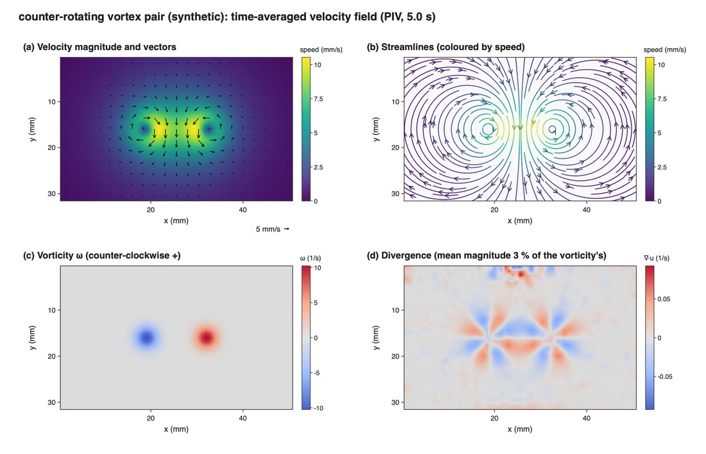 | 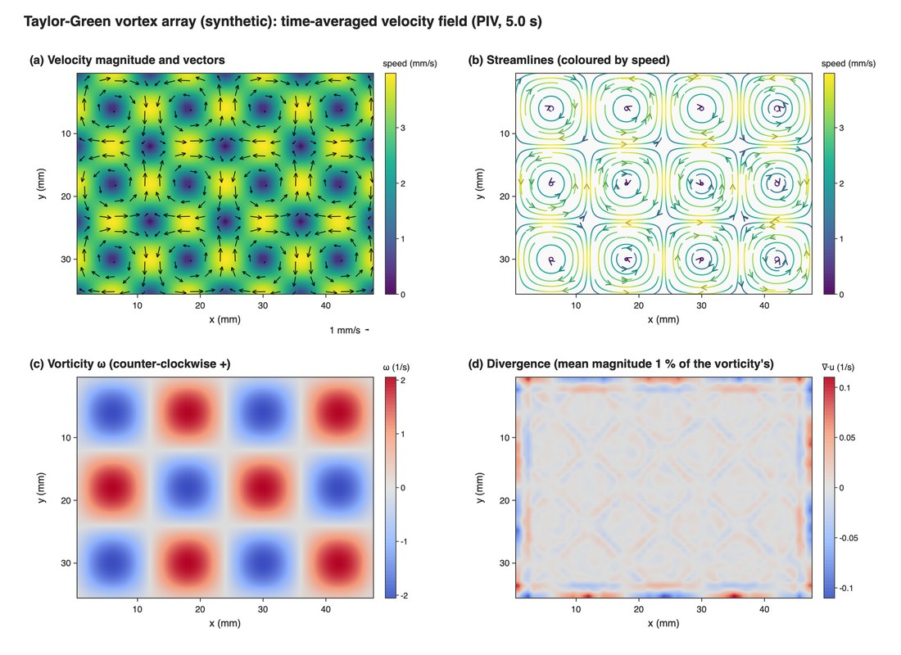 |
| **Counter-rotating vortex pair.** Speed and vectors, evenly spaced streamlines, vorticity (sign shown), divergence as a check of planar flow. Mean field within 0.32 % of the exact flow. | **Taylor–Green vortex array**, twelve cells of alternating rotation. 0.23 %. |
| 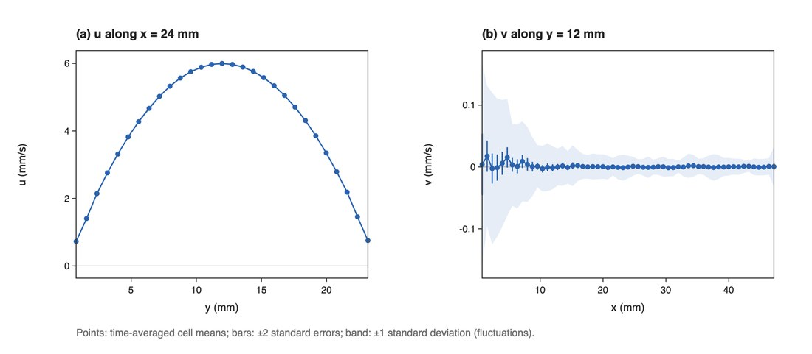 | 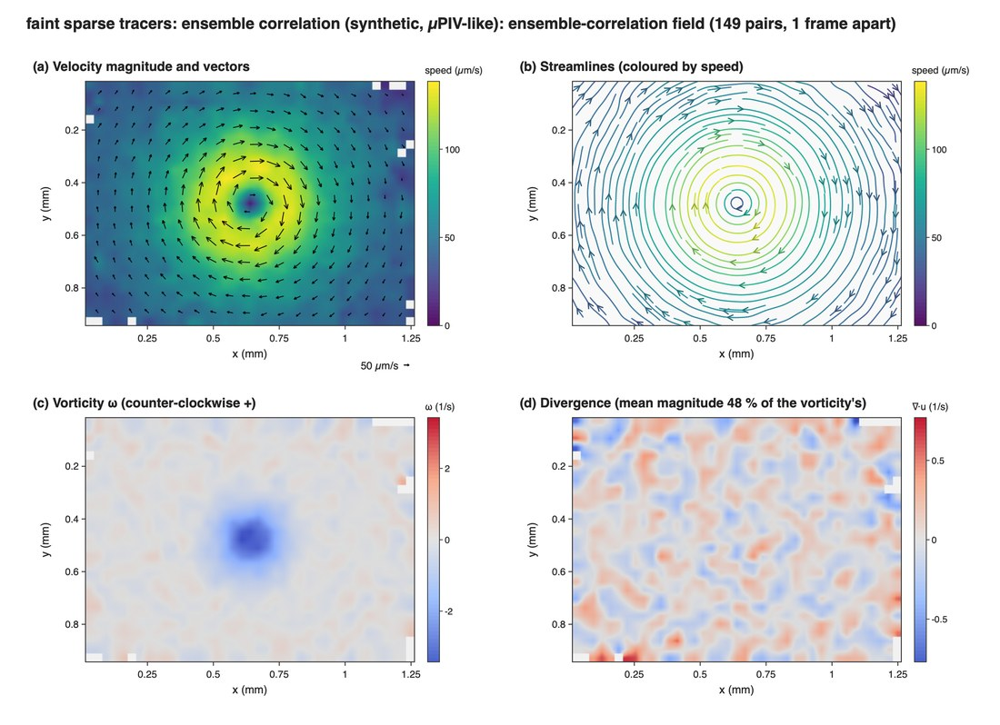 |
| **Channel (Poiseuille) flow.** Centre-line profiles with ±2 standard errors and the ±1 SD fluctuation band. 0.81 %. | **Faint, sparse, Brownian tracers (µPIV-like).** Ensemble correlation over 149 pairs: 7.4 % error, where averaging single-pair vectors gives 11.8 %. |
| 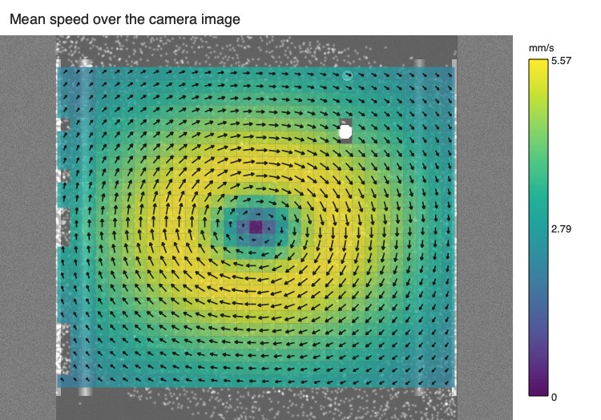 | 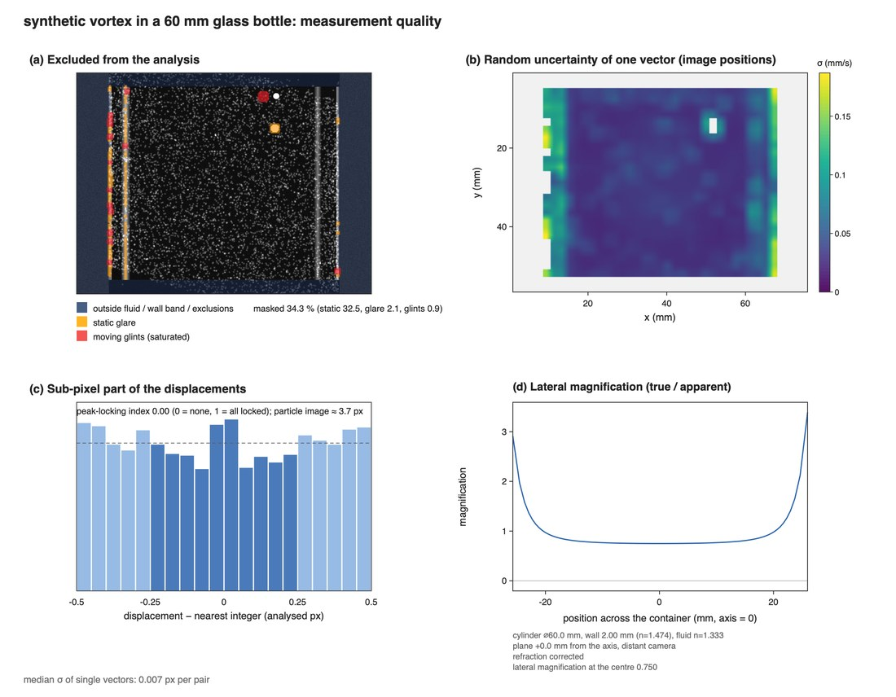 |
| **Over the camera image.** The bottle case above, true velocities at their apparent positions. | **Measurement quality.** What was masked and why, the random uncertainty of single vectors, the sub-pixel histogram (peak locking), the bottle's magnification. |

**Real recordings.** OpenPIV's sample PIV recordings, analysed by LivePTV (blue vectors). There is no ground truth;
LivePTV and OpenPIV agree to a median of 0.02–0.07 px, and LivePTV takes 6–94 ms per pair where OpenPIV takes
0.2–4 s ([details](#real-recordings)).

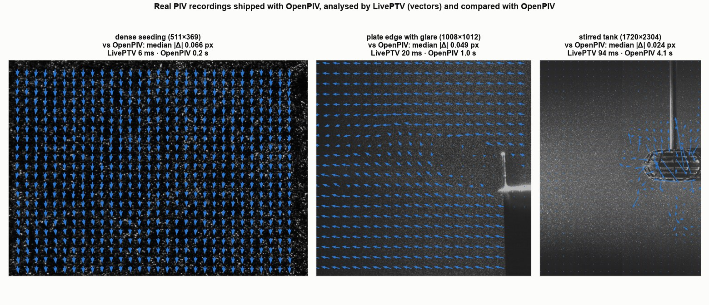

**Brownian motion, real microscopy video.** trackpy's `bulk_water` sample (1 µm latex spheres in water, 24 fps)
played into the app as a video file, PTV mode: tracks, the diffusion coefficient and the Stokes–Einstein diameter.
With the same estimator, LivePTV and trackpy agree within 1 % (lag 1–2: 1,252 vs 1,243 nm) and 4 % (10-lag MSD fit:
983 vs 1,021 nm) ([details](#particle-tracking)).

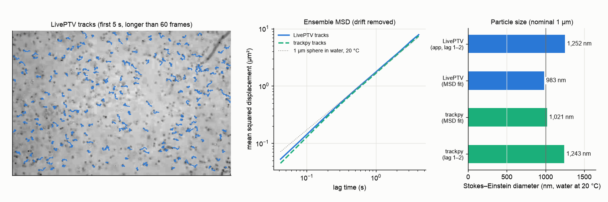

**Camera motion.** A camera on a stand that sways about its foot, 900 px below the picture, through the full
pipeline: the apparent velocity fluctuation of the static border falls from 13.96 to 1.20 px/s, the turning point is
located within 25 px and reported as outside the frame, and PTV particle velocities improve from 10.52 to 3.55 px/s
RMS error. Rolling-shutter shear with keystone: 1.46 px/s with the automatic model, 4.87 px/s with shift + rotation +
zoom only. The mean field is not the issue (zero-mean shake averages out); fluctuation and turbulence statistics,
and every single PTV step, are. Synthetic Brownian PTV through the pipeline: D within 3 % of the true value,
Stokes–Einstein 557 nm for true 572 nm.

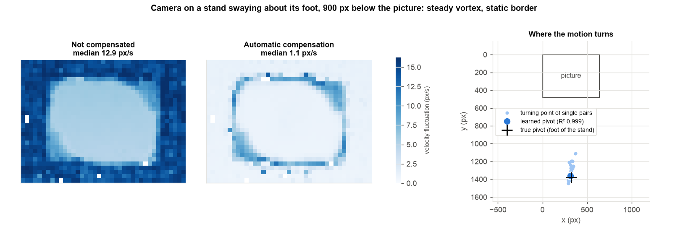

## How it compares

LivePTV was run against [OpenPIV](https://github.com/OpenPIV/openpiv-python) 0.26.3 (iterative image deformation, the
same family as PIVlab) and [trackpy](https://github.com/soft-matter/trackpy) 0.7 on identical images. Scripts, raw
results and how to rerun them: [benchmarks/](benchmarks/).

### Capabilities

From public documentation, release notes and source code (November 2026). Commercial tools were not tested.

| | LivePTV 0.8 | PIVlab 3.14 / 4.0 β | OpenPIV 0.26 | PaIRS-UniNa 0.2 | DaVis 11, DynamicStudio, Insight 4G | trackpy 0.7 |
| --- | --- | --- | --- | --- | --- | --- |
| Runs on | iPad, Mac | MATLAB, Windows app | Python | Windows, macOS, Linux | Windows | Python |
| Analysis while filming | **yes** (GPU) | camera control and live image; live PIV not implemented | no | no | vendor "real-time / online" modes | no |
| Iterative image deformation | yes | yes | yes | yes | yes | – |
| Per-vector uncertainty | yes (correlation statistics) | yes (image matching) | no (signal-to-noise only) | no | yes | – |
| Ensemble correlation | yes | yes | no | statistics only | yes | – |
| Refraction through a round container | **yes, live** | no | no | yes (offline) | not documented | – |
| Lens distortion, stereo, 3-D | no | distortion, stereo (4.0 β) | no | yes | yes (incl. Shake-the-Box) | – |
| Particle tracking | 2-D, live | no | no | no | 3-D LPT / Shake-the-Box | 2-D and N-D, offline |
| Report with methods paragraph | yes | – | – | – | – | – |
| Licence | MIT | MIT | GPL-3.0 | LGPL-3.0 | commercial | BSD-3 |

### Accuracy on synthetic images with known truth

Same images for every tool: erf-integrated Gaussian particle images (2.5 px), light sheet, 2 grey levels of noise, 8 bit.
Windows 64 → 32 px, 50 % overlap, three final iterations for both PIV tools.

| Measure | LivePTV 0.7 | **LivePTV 0.8** | OpenPIV 0.26 |
| --- | --- | --- | --- |
| Vector position error (shear flow) | 0.5 px | **0.003 px** | 0.004–0.014 px |
| Largest sub-pixel bias, uniform flow | 0.003 px | **0.003 px** | 0.016 px |
| Random error, uniform flow | **0.0060 px** | 0.0066 px | 0.0092 px |
| Shortest wavelength kept at 90 % amplitude (32-px windows) | 127 px | 80 px (65 px unfiltered) | **63 px** |
| Lamb–Oseen vortex, core 60 px: RMS error | 0.041 px | **0.008 px** | 0.018 px |
| Lamb–Oseen vortex, core 30 px: RMS error | 0.111 px | **0.023 px** | 0.053 px |
| Sparse seeding (0.005 particles/px): RMS error | 0.111 px | **0.040 px** | 0.073 px |
| Heavy noise (σ = 24 grey levels): RMS error | 0.090 px | **0.081 px** | 0.103 px |

<p align="center">
  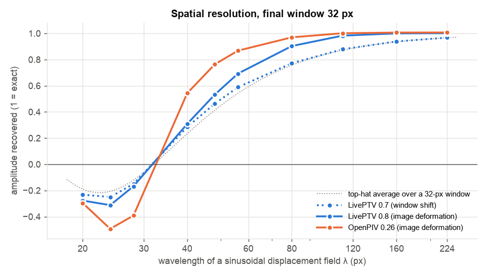
  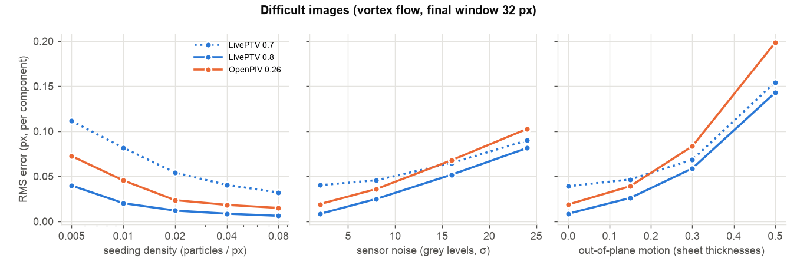
</p>
<p align="center">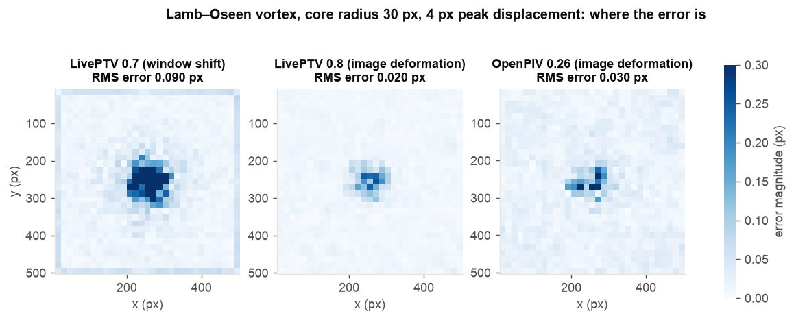</p>

Where LivePTV 0.8 does not lead: OpenPIV keeps slightly finer detail at default settings, because LivePTV filters its
deformation predictor to keep the noise down (switch *Smooth the predictor* off: 65 px, at about twice the random
error). In uniform flow there is nothing to resolve and the predictor adds a little noise (0.0060 → 0.0066 px), and on
18 faint, difficult image pairs the valid share drops from 88.5 to 87.0 %.

### Real recordings

| OpenPIV sample | Size | LivePTV vs OpenPIV: median difference | within 0.2 px | LivePTV | OpenPIV |
| --- | --- | --- | --- | --- | --- |
| test1, dense seeding | 511 × 369 | 0.066 px | 95 % | 6 ms | 0.19 s |
| test2, plate edge with glare | 1008 × 1012 | 0.049 px | 83 % | 20 ms | 1.0 s |
| test4, stirred tank | 1720 × 2304 | 0.024 px | 93 % | 94 ms | 4.1 s |
| test5, tank with a glint (nearly still) | 1024 × 1024 | 0.021 px | 96 % | 22 ms | 1.0 s |

Both tools produce scattered vectors in regions without particles (behind the plate in test2); LivePTV's are somewhat
wilder there.

### Particle tracking

Detection on single frames (particle images 1.5–4 px, noise σ 2–8 grey levels, 0.002–0.01 particles/px), tracking
of exact positions plus 0.05 px noise in a Taylor–Green flow with 2 % of the particles replaced per frame, and the
whole chain from images. trackpy's minimum mass was tuned per condition for its best F1; LivePTV runs on defaults.

<p align="center">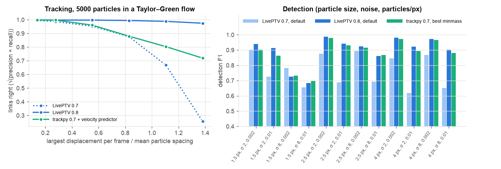</p>

| Measure | LivePTV 0.7 | **LivePTV 0.8** | trackpy 0.7 |
| --- | --- | --- | --- |
| Detection recall, 0.01 particles/px (2.5–4 px images) | 0.45–0.53 | **0.76–0.89** | 0.77–0.87 (tuned) |
| Detection precision, worst condition | 0.990 | **0.997** | 0.983 |
| Localisation error | 0.04–0.14 px | 0.06–0.15 px | 0.08–0.19 px |
| Links right (precision / recall), 5000 particles, 10 px/frame = 1.4 spacings | 0.32 / 0.21 | **0.98 / 0.97** | 0.77 / 0.67 |
| Same, 6 px/frame = 0.8 spacings | 0.90 / 0.86 | **0.995 / 0.994** | 0.90 / 0.86 |
| From images, 3000 particles at 5 px/frame: samples per frame, share off by > 0.5 px | 1,084, 3.8 % | 1,887, **2.7 %** | 2,107, 8.1 % |
| Brownian D, synthetic (true 3.5 px²/s), lag 1–2 / 10-lag MSD | +37 % / +26 % | **+3 % / +4 %** | +5 % / +1 % |

What changed in 0.8: a threshold from the median and MAD of the image (particles no longer raise it), a running
background that does not learn the particles (slow particles were pushed along their motion, inflating Brownian D),
global minimum-cost assignment instead of nearest-first, a search radius that grows with speed, and a
neighbour-consistency vote for tracks without a prediction yet. Where it does not lead: small particle images
(1.5 px) in heavy noise, where recall fell from 0.65 to 0.57 (trackpy 0.58).

**Real video (trackpy `bulk_water`).** LivePTV through the app pipeline, trackpy as in its walkthrough, both drift
corrected. With the same estimator the two agree: lag 1–2 (LivePTV's estimator, localisation noise removed) 0.342 vs
0.345 µm²/s, 10-lag MSD fit 0.436 vs 0.420 µm²/s. The recording spreads slightly faster than diffusive (MSD exponent
1.07), so the two estimators differ by 25 %; the MSD fit gives 983 / 1,021 nm for the nominal 1 µm spheres at 20 °C.

### Speed

<p align="center">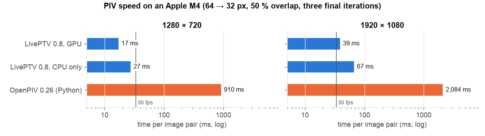</p>

| Task (Apple M4, analysis engine) | LivePTV 0.8 | Reference |
| --- | --- | --- |
| PIV, 1280 × 720 pair (64 → 32 px, deformation, 3 iterations) | 17 ms on the GPU, 27 ms CPU only | OpenPIV 0.26: 0.91 s |
| PIV, 1920 × 1080 pair | 39 ms on the GPU, 67 ms CPU only | OpenPIV 0.26: 2.1 s |
| PTV, 1920 × 1080 frame with ~20,000 particles (detect + track) | 52 ms (17,500 found) | trackpy 0.7: 0.49 s (10,700 found) |
| PIV on OpenPIV's real samples (511 × 369 … 1720 × 2304) | 6–94 ms | OpenPIV 0.26: 0.19–4.1 s |

OpenPIV and trackpy ran in one Python process, as they do by default; both can be parallelised over image pairs.
LivePTV's numbers are per pair inside one process, so they set the live frame rate. iPad timings are not measured yet.

<!-- experiments:start -->
## Experiments

Every number below is read from [`benchmarks/results`](benchmarks/results) by [`make_readme_tables.py`](benchmarks/python/make_readme_tables.py); how to rerun them is in [benchmarks/README.md](benchmarks/README.md). Synthetic images: Gaussian particle images integrated over each pixel, a light sheet, Gaussian noise, 8 bit, exact displacement. LivePTV 0.7 is the previous release (window shift), LivePTV 0.8 this version, both with default settings unless stated. Click a line to open it.

<details>
<summary><b>E0 · Vector positions</b> — LivePTV 0.7 reported every vector 0.5 px off its window centre; 0.8: < 0.01 px</summary>

A linear shear (gradient 0.04 px/px) along y and along x: the error at a vector divided by the gradient is how far the vector sits from where it was measured.

|  | shear along y | shear along x |
| --- | --- | --- |
| LivePTV 0.7 | +0.564 px | +0.434 px |
| LivePTV 0.8 | +0.003 px | -0.001 px |
| OpenPIV 0.26 | +0.014 px | -0.004 px |

</details>

<details>
<summary><b>E1 · Sub-pixel bias and random error (uniform flow)</b> — smallest bias of the tools (0.003 px at 2.5 px images, OpenPIV 0.016 px)</summary>

Uniform displacement 2 + f px (x) and 1 + f px (y), f = 0 … 1 in steps of 0.1; 0.04 particles/px (0.025 for 4 px); noise 2 grey levels; 3 pairs of 384 × 384 px per step. Cells: largest systematic error / mean random error (px).

| particle images | LivePTV 0.7 | LivePTV 0.8 | LivePTV, bilinear option | OpenPIV 0.26 |
| --- | --- | --- | --- | --- |
| 1.0 px | 0.0351 / 0.0353 | 0.0360 / 0.0470 | 0.0805 / 0.0419 | 0.0534 / 0.0491 |
| 1.6 px | 0.0132 / 0.0153 | 0.0133 / 0.0182 | 0.0787 / 0.0165 | 0.0300 / 0.0216 |
| 2.5 px | 0.0031 / 0.0060 | 0.0031 / 0.0066 | 0.0639 / 0.0075 | 0.0164 / 0.0092 |
| 4.0 px | 0.0008 / 0.0060 | 0.0008 / 0.0067 | 0.0365 / 0.0071 | 0.0061 / 0.0101 |

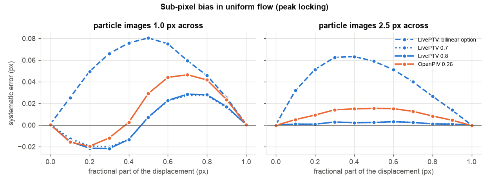

</details>

<details>
<summary><b>E2 · Spatial resolution (sinusoidal displacement)</b> — 90 % amplitude down to λ = 80 px (0.7: 127, OpenPIV: 63)</summary>

Displacement dy = sin(2πx/λ + φ) px (random φ), 768 × 256 px, 0.05 particles/px, 2.5 px images. Recovered amplitude (1 = exact, negative = phase reversed) with the outlier test off; the last two columns give the shortest wavelength kept at 90 % amplitude without and with the normalised median test.

| λ (px) → | 20 | 24 | 28 | 40 | 48 | 56 | 80 | 112 | 160 | 224 | λ₉₀ (px) | λ₉₀, with test |
| --- | --- | --- | --- | --- | --- | --- | --- | --- | --- | --- | --- | --- |
| LivePTV 0.7 | -0.23 | -0.25 | -0.15 | 0.29 | 0.46 | 0.59 | 0.77 | 0.88 | 0.94 | 0.97 | 127 | 131 |
| LivePTV 0.8 | -0.28 | -0.31 | -0.17 | 0.31 | 0.53 | 0.69 | 0.90 | 0.98 | 1.00 | 1.00 | 80 | 103 |
| 0.8, predictor unfiltered | -0.29 | -0.44 | -0.32 | 0.50 | 0.73 | 0.85 | 0.97 | 1.00 | 1.00 | 1.00 | 65 | 89 |
| 0.8, 16-px windows | 0.26 | 0.48 | 0.64 | 0.88 | 0.94 | 0.97 | 0.99 | 1.00 | 1.00 | 1.00 | 43 | 45 |
| OpenPIV 0.26 | -0.30 | -0.49 | -0.39 | 0.54 | 0.76 | 0.87 | 0.97 | 1.00 | 1.01 | 1.01 | 63 | 93 |
| OpenPIV, 16-px windows | 0.43 | 0.64 | 0.75 | 0.91 | 0.95 | 0.97 | 0.99 | 1.00 | 1.01 | 1.01 | 39 | 41 |

With a window of 32 px, a plain window average (top-hat) keeps 0.64 at λ = 64 px and 90 % only at λ ≈ 125 px; LivePTV 0.7 sat on that curve. The median test removes some correct vectors where neighbours differ strongly (λ ≲ 3 vector spacings), in both tools.

</details>

<details>
<summary><b>E3 · Vortices</b> — core 30 px: 0.023 px (0.7: 0.111, OpenPIV: 0.053)</summary>

Lamb–Oseen vortices in 512 × 512 px images (0.04 particles/px, 2.5 px images, noise 2): core radius 60 px with 3 px peak displacement, and 30 px with 4 px. RMS error per component (px) over the whole field; peak vorticity relative to the exact field sampled on the same grid.

|  | core 60 px: RMS | core 30 px: RMS | core 30 px: off > 0.5 px | core 30 px: peak vorticity |
| --- | --- | --- | --- | --- |
| LivePTV 0.7 | 0.0409 | 0.1106 | 1.5 % | 0.98 |
| LivePTV 0.8 | 0.0084 | 0.0232 | 0.0 % | 0.95 |
| 0.8, predictor unfiltered | 0.0130 | 0.0366 | 0.2 % | 0.98 |
| 0.8, 16-px windows | 0.0170 | 0.0196 | 0.0 % | 0.99 |
| OpenPIV 0.26 | 0.0183 | 0.0532 | 0.5 % | 1.01 |
| OpenPIV, 16-px windows | 0.0253 | 0.0338 | 0.0 % | 1.01 |


</details>

<details>
<summary><b>E4 · Large displacements</b> — both tools to 29 px with every vector valid</summary>

Uniform displacement (D, D/2) with the default 64 → 32 px schedule. Cells: RMS error (px) / valid vectors. LivePTV also adapts the frame spacing so the typical displacement stays near 2 px.

| displacement | LivePTV 0.8 | OpenPIV 0.26 |
| --- | --- | --- |
| 2.2 px | 0.0058 / 100 % | 0.0075 / 100 % |
| 6.7 px | 0.0061 / 100 % | 0.0081 / 100 % |
| 11.2 px | 0.0060 / 100 % | 0.0083 / 100 % |
| 15.7 px | 0.0061 / 100 % | 0.0088 / 100 % |
| 20.1 px | 0.0060 / 100 % | 0.0088 / 100 % |
| 24.6 px | 0.0061 / 100 % | 0.0093 / 100 % |
| 29.1 px | 0.0058 / 100 % | 0.0094 / 100 % |

</details>

<details>
<summary><b>E5 · Difficult images and the reported uncertainty</b> — ahead of OpenPIV in every condition; uncertainty within ×0.84–1.48 of the actual error</summary>

The weak vortex of E3 with one condition changed at a time (base: 0.04 particles/px, noise 2, no out-of-plane motion). RMS error per component (px), and the per-vector uncertainty LivePTV reports (correlation statistics) divided by the actual error.

| particles / px | LivePTV 0.7 | LivePTV 0.8 | OpenPIV 0.26 | 0.8: predicted ÷ actual | 0.7: predicted ÷ actual |
| --- | --- | --- | --- | --- | --- |
| 0.005 | 0.1114 | 0.0398 | 0.0725 | 1.13 | 0.91 |
| 0.01 | 0.0816 | 0.0202 | 0.0455 | 1.28 | 1.01 |
| 0.02 | 0.0541 | 0.0120 | 0.0235 | 1.46 | 1.13 |
| 0.04 | 0.0404 | 0.0085 | 0.0183 | 1.43 | 1.17 |
| 0.08 | 0.0320 | 0.0061 | 0.0149 | 1.44 | 1.20 |

| noise σ (grey levels) | LivePTV 0.7 | LivePTV 0.8 | OpenPIV 0.26 | 0.8: predicted ÷ actual | 0.7: predicted ÷ actual |
| --- | --- | --- | --- | --- | --- |
| 2 | 0.0401 | 0.0083 | 0.0191 | 1.48 | 1.21 |
| 8 | 0.0456 | 0.0249 | 0.0359 | 0.93 | 1.16 |
| 16 | 0.0647 | 0.0518 | 0.0679 | 0.86 | 1.04 |
| 24 | 0.0898 | 0.0813 | 0.1025 | 0.87 | 0.99 |

| out-of-plane motion (sheet thicknesses) | LivePTV 0.7 | LivePTV 0.8 | OpenPIV 0.26 | 0.8: predicted ÷ actual | 0.7: predicted ÷ actual |
| --- | --- | --- | --- | --- | --- |
| 0.0 | 0.0390 | 0.0085 | 0.0187 | 1.43 | 1.21 |
| 0.15 | 0.0465 | 0.0259 | 0.0390 | 0.90 | 1.14 |
| 0.3 | 0.0684 | 0.0588 | 0.0834 | 0.84 | 1.03 |
| 0.5 | 0.1545 | 0.1429 | 0.1984 | 0.86 | 0.98 |


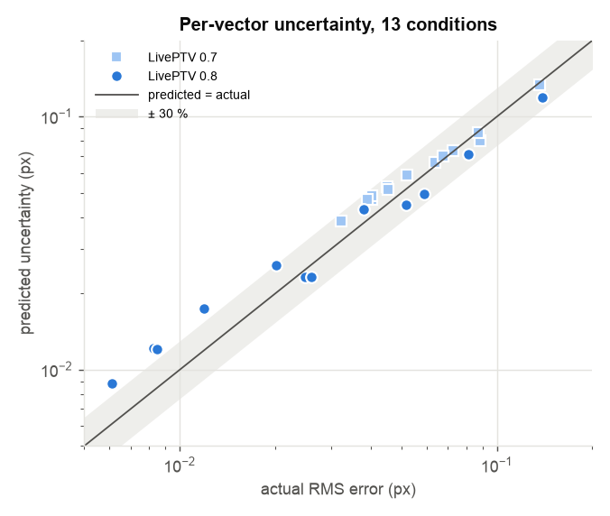

The reported uncertainty covers random error. With image deformation it is conservative on clean images (up to ×1.5) and about 15 % low on noisy ones.

</details>

<details>
<summary><b>E6 · Speed</b> — PIV 17 ms (720p) / 39 ms (1080p) per pair; PTV 52 ms for 20,000 particles</summary>

Apple M4 (Mac), median over repeated pairs; LivePTV's analysis engine in one process, OpenPIV and trackpy in one Python process (their default). PIV: 64 → 32 px, 50 % overlap, three final iterations for both.

| task | LivePTV, GPU | LivePTV, CPU only | reference |
| --- | --- | --- | --- |
| PIV 1280 × 720 | 17.2 ms | 27.3 ms | OpenPIV 910 ms |
| PIV 1920 × 1080 | 38.8 ms | 67.0 ms | OpenPIV 2084 ms |
| PTV 1920 × 1080, ~20,000 particles | – | 52 ms (17,524 found) | trackpy 487 ms (10,712 found) |

</details>

<details>
<summary><b>R1 · Real PIV recordings</b> — the two tools agree to a median of 0.02–0.07 px</summary>

OpenPIV's sample recordings (real images, shipped with the `openpiv` package), both tools at 64 → 32 px with image deformation and three final iterations. No ground truth: OpenPIV is interpolated to LivePTV's vector positions and the difference is reported.

| recording | scene | median difference | 90th percentile | within 0.2 px | LivePTV valid | LivePTV | OpenPIV |
| --- | --- | --- | --- | --- | --- | --- | --- |
| OpenPIV test1 | dense seeding (511×369) | 0.066 px | 0.16 px | 95 % | 97.6 % | 6 ms | 0.19 s |
| OpenPIV test2 | plate edge with glare (1008×1012) | 0.049 px | 0.38 px | 83 % | 93.1 % | 20 ms | 1.03 s |
| OpenPIV test4 | stirred tank (1720×2304) | 0.024 px | 0.10 px | 93 % | 93.6 % | 94 ms | 4.05 s |
| OpenPIV test5 | tank with a glint (1024×1024) | 0.021 px | 0.10 px | 96 % | 97.3 % | 22 ms | 1.05 s |

</details>

<details>
<summary><b>P1 · Particle detection</b> — recall up from 0.45–0.53 to 0.76–0.89 in dense images, precision ≥ 0.997</summary>

Single 512 × 512 frames, particles in a light sheet (so some are faint), recall counted over particles that rise above max(15, 3σ) grey levels. Cells: recall / precision / localisation error (px). The tuned columns sweep LivePTV's k and trackpy's minimum mass for the best F1.

| particle images | noise | particles/px | LivePTV 0.7 | LivePTV 0.8 (defaults) | LivePTV 0.8, best k | trackpy 0.7, best minmass |
| --- | --- | --- | --- | --- | --- | --- |
| 1.5 px | 2 | 0.002 | 0.82 / 1.000 / 0.074 | 0.89 / 1.000 / 0.076 | 0.96 / 0.982 / 0.085 (k 4) | 0.82 / 1.000 / 0.105 (20) |
| 1.5 px | 2 | 0.01 | 0.57 / 0.999 / 0.087 | 0.84 / 0.999 / 0.092 | 0.90 / 0.973 / 0.098 (k 3) | 0.76 / 0.998 / 0.117 (20) |
| 1.5 px | 8 | 0.002 | 0.65 / 0.990 / 0.143 | 0.57 / 1.000 / 0.141 | 0.70 / 0.977 / 0.145 (k 4) | 0.58 / 0.994 / 0.158 (40) |
| 1.5 px | 8 | 0.01 | 0.49 / 1.000 / 0.144 | 0.52 / 1.000 / 0.144 | 0.77 / 0.939 / 0.171 (k 3) | 0.54 / 1.000 / 0.180 (40) |
| 2.5 px | 2 | 0.002 | 0.78 / 1.000 / 0.044 | 0.98 / 1.000 / 0.058 | 0.98 / 1.000 / 0.058 (k 5) | 0.96 / 1.000 / 0.081 (20) |
| 2.5 px | 2 | 0.01 | 0.52 / 1.000 / 0.095 | 0.89 / 1.000 / 0.090 | 0.90 / 1.000 / 0.090 (k 4) | 0.87 / 0.999 / 0.108 (20) |
| 2.5 px | 8 | 0.002 | 0.81 / 1.000 / 0.101 | 0.86 / 1.000 / 0.106 | 0.92 / 0.990 / 0.117 (k 4) | 0.85 / 1.000 / 0.119 (40) |
| 2.5 px | 8 | 0.01 | 0.53 / 1.000 / 0.115 | 0.76 / 1.000 / 0.122 | 0.88 / 0.987 / 0.141 (k 3) | 0.77 / 0.998 / 0.145 (40) |
| 4 px | 2 | 0.002 | 0.73 / 1.000 / 0.043 | 0.96 / 1.000 / 0.057 | 0.96 / 1.000 / 0.057 (k 4) | 0.95 / 0.995 / 0.076 (40) |
| 4 px | 2 | 0.01 | 0.45 / 0.997 / 0.130 | 0.86 / 0.998 / 0.121 | 0.86 / 0.998 / 0.121 (k 3) | 0.82 / 0.987 / 0.176 (40) |
| 4 px | 8 | 0.002 | 0.77 / 1.000 / 0.102 | 0.95 / 0.997 / 0.130 | 0.97 / 0.989 / 0.132 (k 4) | 0.94 / 0.988 / 0.143 (80) |
| 4 px | 8 | 0.01 | 0.48 / 0.998 / 0.143 | 0.82 / 0.999 / 0.148 | 0.87 / 0.991 / 0.156 (k 3) | 0.80 / 0.983 / 0.189 (80) |


</details>

<details>
<summary><b>P2 · Particle tracking</b> — 0.98 / 0.97 at 1.4 particle spacings per frame (0.7: 0.32 / 0.21, trackpy: 0.77 / 0.67)</summary>

Exact particle positions (+0.05 px noise) in a Taylor–Green vortex array, 512 × 512 px, 20 frames, 2 % of the particles replaced per frame (out-of-plane loss). Cells: precision / recall of frame-to-frame links; the search radius of trackpy is 1.5 U + 2 px.

| particles | max displacement | ÷ mean spacing | LivePTV 0.7 | LivePTV 0.8 | trackpy | trackpy + predictor |
| --- | --- | --- | --- | --- | --- | --- |
| 2000 | 1 px | 0.09 | 0.998 / 0.998 | 0.999 / 0.998 | 0.999 / 0.999 | 0.999 / 0.999 |
| 2000 | 2 px | 0.17 | 0.995 / 0.995 | 0.999 / 0.999 | 0.998 / 0.997 | 0.999 / 1.000 |
| 2000 | 4 px | 0.35 | 0.982 / 0.981 | 0.999 / 0.999 | 0.986 / 0.984 | 0.997 / 0.998 |
| 2000 | 6 px | 0.52 | 0.959 / 0.945 | 0.998 / 0.997 | 0.879 / 0.843 | 0.984 / 0.980 |
| 2000 | 8 px | 0.70 | 0.923 / 0.886 | 0.995 / 0.994 | 0.585 / 0.492 | 0.930 / 0.904 |
| 2000 | 10 px | 0.87 | 0.797 / 0.675 | 0.992 / 0.988 | 0.388 / 0.298 | 0.881 / 0.832 |
| 5000 | 1 px | 0.14 | 0.995 / 0.996 | 0.998 / 0.998 | 0.997 / 0.998 | 0.998 / 0.998 |
| 5000 | 2 px | 0.28 | 0.986 / 0.987 | 0.998 / 0.998 | 0.992 / 0.991 | 0.997 / 0.998 |
| 5000 | 4 px | 0.55 | 0.957 / 0.949 | 0.998 / 0.997 | 0.817 / 0.764 | 0.966 / 0.955 |
| 5000 | 6 px | 0.83 | 0.895 / 0.858 | 0.995 / 0.994 | 0.456 / 0.355 | 0.902 / 0.858 |
| 5000 | 8 px | 1.10 | 0.722 / 0.619 | 0.989 / 0.987 | 0.232 / 0.162 | 0.841 / 0.768 |
| 5000 | 10 px | 1.38 | 0.321 / 0.206 | 0.979 / 0.970 | 0.150 / 0.099 | 0.771 / 0.672 |

**What each part contributes** (the same datasets with one part of the tracker switched off; [`ptv_ablation.py`](benchmarks/python/ptv_ablation.py)):

| tracker | mean over the 12 cases | 2000 particles, 10 px | 5000 particles, 10 px |
| --- | --- | --- | --- |
| LivePTV 0.8 (defaults) | 0.995 / 0.993 | 0.992 / 0.988 | 0.979 / 0.970 |
| closest-first instead of global assignment | 0.983 / 0.980 | 0.969 / 0.961 | 0.916 / 0.893 |
| no speed-dependent gate (factor 0) | 0.995 / 0.994 | 0.992 / 0.988 | 0.981 / 0.973 |
| speed-dependent gate factor 0.3 | 0.994 / 0.993 | 0.992 / 0.989 | 0.975 / 0.968 |
| no acceleration term | 0.995 / 0.993 | 0.993 / 0.986 | 0.978 / 0.961 |
| neighbour prediction and first-frame vote off | 0.855 / 0.813 | 0.806 / 0.700 | 0.315 / 0.206 |

The neighbour-consistency vote for tracks without a prediction and the global assignment make the difference; without the vote the tracker falls back to the 0.7 level. The speed-dependent gate does nothing within these cases; it is there for faster, sparser flows (separate datasets, search radius 24 px; gate factor 0 / 0.1 (default) / 0.3):

| flow | factor 0 | factor 0.1 | factor 0.3 |
| --- | --- | --- | --- |
| 2000 particles, 12 px/frame | 0.986 / 0.975 | 0.987 / 0.978 | 0.988 / 0.978 |
| 2000 particles, 16 px/frame | 0.689 / 0.446 | 0.811 / 0.644 | 0.888 / 0.798 |
| 5000 particles, 12 px/frame | 0.933 / 0.889 | 0.942 / 0.906 | 0.807 / 0.720 |

0.3 would help the sparse case more but costs the dense one.

</details>

<details>
<summary><b>P3 · From images to particle velocities</b> — 75 % more samples than 0.7 and the fewest bad ones</summary>

3000 particles in the Taylor–Green flow rendered as images (2.5 px particles, noise 4), 12 frames, detection and tracking with each tool's defaults (trackpy: diameter 5, minimum mass 20, velocity predictor). Cells: velocity samples per frame / RMS error (px) / share off by more than 0.5 px.

| flow | LivePTV 0.7 | LivePTV 0.8 | trackpy 0.7 |
| --- | --- | --- | --- |
| 2 px/frame | 1,067 / 0.181 / 3.0 % | 1,866 / 0.173 / 2.3 % | 2,094 / 0.227 / 4.4 % |
| 5 px/frame | 1,084 / 0.459 / 3.8 % | 1,887 / 0.369 / 2.7 % | 2,107 / 0.863 / 8.1 % |

</details>

<details>
<summary><b>B · Brownian motion and particle size</b> — D within 3 % on synthetic particles (0.7: +37 %); the tools agree on the real video</summary>

**Synthetic, known D.** Particles made to resemble the real sample (6.4 px images, D = 3.5 px²/s at 24 fps, slow drift, 300 frames); both trackings evaluated with the same estimators after removing stubs and drift.

|  | D error, lag 1–2 (noise removed) | D error, 10-lag MSD fit | localisation σ |
| --- | --- | --- | --- |
| LivePTV 0.7 | +37 % | +26 % | 0.097 px |
| LivePTV 0.8 | +3 % | +4 % | 0.038 px |
| trackpy 0.7 | +5 % | +1 % | 0.079 px |

LivePTV 0.7's background learned the slow particles and pushed them along their motion.

**Real video.** trackpy's `bulk_water` sample (1 µm latex spheres in water, 24 fps, 2.85 px/µm); Stokes–Einstein diameter at 20 °C (nominal 1,000 nm).

|  | lag 1–2 | 10-lag MSD fit |
| --- | --- | --- |
| LivePTV 0.8 (app pipeline) | 0.342 µm²/s → 1,252 nm | 0.436 µm²/s → 983 nm |
| trackpy 0.7 (walkthrough settings) | 0.345 µm²/s → 1,243 nm | 0.420 µm²/s → 1,021 nm |

The recording spreads slightly faster than diffusive (MSD exponent 1.07), so the two estimators differ; with the same estimator the tools agree.

</details>

<details>
<summary><b>C · Camera motion</b> — fluctuation 13.96 → 1.20 px/s for a stand swaying about its foot; pivot within 25 px</summary>

The synthetic camera moves the whole picture each frame (rotation about a chosen point, shift, zoom, shear, keystone) over a steady vortex with a static textured border; the full pipeline runs with compensation off or automatic. A steady flow has no real fluctuation, so what remains is camera motion left over.

| case | without / before | with |
| --- | --- | --- |
| stand sways about its foot, 900 px below the picture: static border fluctuation | 13.96 px/s | 1.20 px/s |
| same: flow fluctuation | 5.32 px/s | 1.13 px/s |
| same, PTV: velocity RMS error | 10.52 px/s | 3.55 px/s |
| rolling-shutter shear + keystone: static border (similarity model vs automatic) | 4.87 px/s | 1.46 px/s |
| same: flow | 3.56 px/s | 0.88 px/s |

The pivot was found at (311, 1357) px for the true (320, 1380) px (R² 1.00) and reported as outside the frame. Unit tests: a pivot 1500 px below the picture is learned within 25 px; with static background on one side only, shear and keystone are never fitted; a pure shift with noise is fitted as a shift in all 65 pairs. The compensation is for fluctuations and single PTV steps: zero-mean shake averages out of the mean field, and there compensation costs a little (mean-field error 0.94 % without, 1.24 % with), because the long-term mean motion is kept as possible flow and its estimate is uncertain.


</details>

<details>
<summary><b>S · Example sessions</b> — 0.2–1.9 % with dense tracers, 7.4 % for faint sparse ones (ensemble correlation)</summary>

Synthetic scenes recorded through the app's pipeline and recorder (`ShowcaseTests`); relative RMS error of the time-averaged field against the exact flow.

| scene | result |
| --- | --- |
| vortex in a 60 mm bottle (reflections, glare, glint, refraction) | 1.9 % (naive analysis 34.5 %) |
| counter-rotating vortex pair | 0.32 % |
| Taylor–Green vortex array | 0.23 % |
| channel (Poiseuille) flow | 0.81 % |
| faint sparse Brownian tracers | ensemble 7.3 %, averaged single pairs 11.8 % |
| Brownian PTV (synthetic) | D 3.078 px²/s for 3.0; 557 nm for 572 nm |

</details>
<!-- experiments:end -->

## What it does

| | |
| --- | --- |
| **Sources** | Insta360 Ace Pro 2 over its own Wi-Fi (community-documented protocol, *not yet verified on hardware*); USB/UVC cameras on iPad and Mac; video files; synthetic flows with known ground truth (vortex, vortex pair, Taylor–Green array, rotation, channel, uniform, Brownian, camera shake) |
| **PIV** | Multi-pass FFT cross-correlation (64 → 32 px) with iterative image deformation (symmetric, 8-tap Lanczos resampling, cubic predictor with noise-adaptive filtering), overlap-unbiased 3-point Gaussian peak fit, correlation threshold, normalised median test, flagged replacement, adaptive pair spacing for slow flows |
| **Uncertainty** | Random uncertainty of every vector from correlation statistics (predicted ÷ actual error 0.72–1.48 over the test and benchmark conditions, see [METHODS §18](docs/METHODS.md#18-limitations-and-recommendations)); noise-corrected fluctuations; standard errors of the mean |
| **Scene corrections** | Running-mean background removal (reflections, labels, scratches); static-glare and moving-glint masks; user exclusions; camera-motion compensation for PIV and PTV: shift, rotation about any point (also far outside the picture, e.g. a stand swaying about its foot, which is located and reported), zoom, rolling-shutter shear and keystone, chosen automatically per pair from what the static background can determine |
| **Containers** | Round bottles and flat tanks: 3-D ray tracing through wall and fluid (Snell's law), length scale from the bottle silhouette, wall band masked, displacements mapped end to end, results resampled on a regular grid in true coordinates |
| **Speed** | Image deformation and the 32-px correlation passes run on the GPU (Metal, shader compiled at run time, so it also works in Swift Playgrounds) with the same vectors as the CPU path (tested to 1e-4 px; deformed frames bit-identical); Apple M4, analysis engine: 17 ms per pair at 1280×720, 39 ms at 1920×1080. Falls back to the CPU (Accelerate) on GPUs older than Apple7 |
| **PTV** | Detection above a robust noise threshold with a background that does not learn the particles, 3-point Gaussian sub-pixel positions, tracking by global minimum-cost assignment with speed-dependent gates and a neighbour-consistency start, Brownian diffusion and Stokes–Einstein size |
| **Also** | Ensemble correlation (µPIV), particle-image diameter and peak-locking diagnostics |
| **Outputs** | Self-contained `report.html`, `methods.txt`, publication figures (PNG + vector PDF), CSV, VTK (ParaView), raw per-frame records, bit-exact preview stream |

How every number is computed, why, and how it was validated: **[docs/METHODS.md](docs/METHODS.md)** (English) /
**[docs/METHODS_ja.md](docs/METHODS_ja.md)** (日本語).

## Validation (all asserted by `./scripts/test.sh`)

| Case | Result |
| --- | --- |
| Vortex in a 60 mm bottle with reflections and glints, end to end | 1.9 % error (naive 34.5 %) |
| Reflection stripe + hot spot + moving glint over a uniform flow | RMS 0.170 → 0.030 px; outliers 2.2 % → 0 % |
| Uniform flow imaged through a 56 mm bottle | 0.451 → 0.046 px |
| Ray tracer vs closed-form optics | ≤ 1.2·10⁻⁴ mm; centre magnification 0.7502 = 1/n |
| Single-vector uncertainty vs actual error | ratio 0.72–0.90 over noise, size and out-of-plane loss |
| Sub-pixel bias of aligned windows | bilinear 0.053 px → Lanczos-4 0.002 px |
| Image deformation vs window shift | Lamb–Oseen vortex 0.104 → 0.022 px; sinusoid at λ = 2 windows: amplitude 0.72 → 0.84 |
| Vector positions; edge rows in a shear flow | offset 0.5 → < 0.1 px; edge vectors replaced 58–71 % → 0 % |
| GPU (Metal) vs CPU correlation, same frames | statuses identical; vectors within 7·10⁻⁵ px (deformed frames bit-identical); uncertainty within 0.1 % |
| Ensemble correlation, faint sparse vortex | 8.5 % vs 11.8 % (vector average); 99 % valid |
| Camera on a stand swaying about a point 900 px below the picture | static-border fluctuation 13.96 → 1.20 px/s; pivot located within 25 px; PTV velocity error 10.52 → 3.55 px/s |
| Rolling-shutter shear + keystone | 1.46 px/s (automatic model) vs 4.87 px/s (shift + rotation + zoom only) |
| Brownian diffusion coefficient | within 4 %; with background removal on, +3 % (was +37 %: slow particles leaked into the background) |
| PTV linking, 5000 particles at 1.4 spacings per frame | precision / recall 0.98 / 0.97 (was 0.32 / 0.21) |

## Measuring a flow in a bottle

1. Fill and seed the bottle (or use the turbidity of the fluid itself). Fix the camera on a stand, perpendicular to
   the bottle, and use the camera's linear (distortion-corrected) mode. A light sheet through the axis defines the
   measurement plane best.
2. In the app, choose the source and start the preview.
3. **Container → Round bottle**, then **Mark container outline**. Drag from one outer edge of the bottle to the other,
   from just below the free surface to just above the base.
4. In *Analysis settings › Container and refraction*, enter the outer diameter, the wall thickness and the materials
   (presets for glass, PMMA, PET, water, glycerol and more). The length scale now comes from the silhouette.
5. Leave *Background removal* on the running mean. Use **Add exclusion** for labels or reflections that are still
   visible. *Show masked areas* displays what is ignored.
6. **Start recording**, then stop. The session folder contains the evaluation, figures, the methods paragraph and all
   raw data (Files app: *On My iPad › LivePTV › Sessions*).

For a flat-walled tank, calibrate mm/px with a target in the measurement plane. Alternatively, calibrate on the outer
wall, give the camera distance, and enable *calibrated on the outer wall*.

## Getting started

**iPad app (Xcode).** Open `LivePTV.xcodeproj`, choose your team under *Signing & Capabilities* (a free Apple ID
works), select your iPad and run. The scheme builds Release (the analysis needs compiler optimisation).
Step-by-step guide in Japanese: [docs/INSTALL_XCODE_ja.md](docs/INSTALL_XCODE_ja.md).
Without Xcode, `./scripts/make-swiftpm.sh` builds a Swift Playgrounds package that runs on the iPad itself (unoptimised,
about 3× slower).

**As a Swift package.** Add `https://github.com/Rhizobium-gits/LivePTV` and depend on `PTVCore` (algorithms only) or
`LivePTVKit` (sources, pipeline, recording, SwiftUI app):

```swift
import PTVCore

// 🐱 the bottle: outer silhouette marked on the image, 60 mm glass bottle with water
var bottle = ContainerGeometry()
bottle.shape = .cylinder
bottle.outline = PixelROI(x: 70, y: 30, width: 500, height: 420)
bottle.outerDiameterMM = 60
bottle.wallThicknessMM = 2
let map = RefractionMap(geometry: bottle, calibrationMMPerPixel: nil)!

// 🐱 per frame, in time order: background + masks, then PIV between consecutive frames
// 🐱 (a, b: LumaImage, the luma plane of two frames as Float)
let suppressor = ReflectionSuppressor()
let engine = PIVEngine()
let walls = StaticMask.build(width: a.width, height: a.height, originX: 0, originY: 0, scale: 1,
                             exclusions: [], container: map)
let pa = suppressor.process(a, staticMask: walls), pb = suppressor.process(b, staticMask: walls)
if var field = engine.compute(a: engine.prepare(pa.image, mask: pa.mask),
                              b: engine.prepare(pb.image, mask: pb.mask), dt: 1.0 / 30) {
    map.correct(&field)            // 🐱 true displacements in the measurement plane
    // field.dx / field.dy (px per pair) × map.mmPerPixel → mm; field.sigmaX / sigmaY: uncertainty
}
```

**Tests and tools on a Mac** (Command Line Tools are enough):

```sh
./scripts/test.sh                                     # 135 tests: algorithms, optics, GPU vs CPU, end-to-end recordings, protocol
cd LivePTVKit
swift run -c release ace-probe benchmark --width 1280 --height 720   # add --gpu 0 to time the CPU-only path
swift run -c release ace-probe probe --seconds 20     # Mac joined to the camera Wi-Fi: hardware check
```

## Repository layout

| Path | What |
| --- | --- |
| `LivePTVKit/Sources/PTVCore` | Algorithms: PIV engine (CPU and Metal GPU correlation), uncertainty, ensemble correlation, background and masks, refraction (ray tracing), shake compensation, PTV detector and tracker, statistics |
| `LivePTVKit/Sources/Pipeline` | Frame pipeline, recording, end-of-measurement evaluation, figures, report, VTK |
| `LivePTVKit/Sources/CameraKit` | Camera sources (Insta360 Wi-Fi client, USB, files, synthetic), H.264/H.265 decoding |
| `LivePTVKit/Sources/LivePTVUI` | SwiftUI app (live view, settings, sessions) |
| `LivePTVKit/Sources/ace-probe` | Mac command line: camera verification, benchmark, USB live analysis |
| `LivePTVKit/Tests` | 135 tests, including the validation cases above (`ShowcaseTests` writes the example sessions when asked) |
| `App/`, `LivePTV.xcodeproj`, `project.yml` | iPad app shell (XcodeGen); the package lives in `LivePTVKit/` because Xcode cannot use the project's own folder as a local package |
| `Package.swift` | Root manifest so the repository can be added by URL |
| `docs/` | [METHODS](docs/METHODS.md), [Japanese methods](docs/METHODS_ja.md), [camera integration report](docs/TECHNICAL_REPORT.md), [Xcode guide (ja)](docs/INSTALL_XCODE_ja.md), example session, README images |
| `benchmarks/` | Comparison with OpenPIV and trackpy: Swift harness, Python scripts, results ([benchmarks/README.md](benchmarks/README.md)) |
| `scripts/` | `test.sh`, `pack.sh` (zip for another Mac), `make-swiftpm.sh` (Swift Playgrounds), `mock_camera.py` |

## Session data

Each recording folder holds:
- `session.json`: every setting, the camera, the calibration and the clock anchor;
- per-frame records (`frames.csv`, `particles.csv`, `velocities.csv`, `field.csv`, `piv_vectors.csv` with
  per-vector uncertainty and status valid / replaced / invalid / masked);
- the received preview stream, bit-exact;
- the evaluation: `report.html`, `evaluation.json`, `methods.txt`, `mean_field.csv` (rectified when a container is
  set), `mean_field.vtk`, and the figures `figure_summary`, `figure_quality`, `figure_profiles`, `figure_timeseries`
  and `figure_ensemble`.

The details are in [docs/METHODS.md §16](docs/METHODS.md#16-outputs).

## Status and limitations

- The Insta360 Ace Pro 2 Wi-Fi protocol is community-documented and tested only against a protocol-accurate mock
  camera. Verify it with `ace-probe` before relying on it ([camera report](docs/TECHNICAL_REPORT.md), §9). USB cameras work.
- Refraction is corrected for one measurement plane. With volume illumination of turbid fluid, the image is
  depth-averaged. See [METHODS §18](docs/METHODS.md#18-limitations-and-recommendations) for this and the other
  assumptions: optical axis, lens distortion, temperature-dependent refractive indices.
- Velocities use camera timestamps. The live preview is compressed; keep the camera's own recording for re-analysis.
- The comparisons use synthetic images (exact truth, no lens or compression) and public sample recordings (no truth).
  PIVlab and commercial packages were not run. iPad hardware speed has not been measured yet (all timings: Apple M4 Mac).

## 日本語の概要

LivePTV は、カメラ映像から流れ場を iPad 上でリアルタイムに計測する PIV/PTV アプリとライブラリです。瓶や水槽越しに撮影する実験で問題になる次の誤差を補正します。

- **瓶の反射・ラベル・傷**: 時間平均の背景を差し引いて除去します。
- **映り込みの強い部分（グレア）と、水面のきらめき**: 自動でマスクします。それ以外に除外したい場所は、画面上で手で指定できます。
- **丸い瓶のレンズ効果**: 水を入れた円筒は、中心付近で幅を約 1.33 倍に、壁際ではそれ以上に引き伸ばして見せます。カメラからの光線を壁と液体の中で屈折させて追跡し（スネルの法則）、測定面上の本当の位置と速度に直します。長さの尺度は瓶の外径とその見かけの幅から決まります。
- **カメラの揺れ**: 静止部分から推定して差し引きます。

すべてのベクトルに不確かさ（相関統計による推定）が付きます。PIV は窓変形（反復画像変形）方式で、画像の変形と 32 px の相関を GPU（Metal）で計算し、CPU と同じベクトル（差 1·10⁻⁴ px 以内）を返します。Apple M4 では 1280×720 の 1 ペアを 17 ms、1920×1080 を 39 ms で解析します。記録を止めると、図（PNG とベクター PDF）、レポート、論文用の手法説明文、CSV、VTK が自動で保存されます。合成データによる検証では、反射と水面のきらめきがある 60 mm ガラス瓶の中の渦を誤差 1.9 % で再現しました。補正なしの解析では 34.5 % でした。

**既存ツールとの比較**（同じ画像で OpenPIV 0.26・trackpy 0.7 と比較。手順と結果は [benchmarks/](benchmarks/)）:

| 項目 | LivePTV 0.8 | OpenPIV 0.26 |
| --- | --- | --- |
| 渦（コア 30 px）の RMS 誤差 | **0.023 px** | 0.053 px |
| 粒子の少ない画像（0.005 個/画素） | **0.040 px** | 0.073 px |
| 一様流のサブピクセル系統誤差 | **0.003 px** | 0.016 px |
| 振幅 90 % を保つ最短の波長（32 px 窓） | 80 px | **63 px** |
| 1 ペアの処理時間（実画像、1008×1012） | **20 ms** | 1.0 s |

| 粒子追跡の項目 | LivePTV 0.8 | trackpy 0.7 |
| --- | --- | --- |
| 正しく結べた割合（粒子 5000 個、1 フレーム 10 px = 粒子間隔の 1.4 倍） | **0.98 / 0.97** | 0.77 / 0.67 |
| ブラウン運動の拡散係数（合成、真値 3.5 px²/s） | +3 % | +5 % |
| 1920×1080・粒子約 2 万個の 1 フレーム（検出 + 追跡） | **52 ms** | 0.49 s |

OpenPIV に同梱の実験画像（正解なし）では、2 つのツールの差は中央値 0.02–0.07 px でした。trackpy の実際の顕微鏡動画（1 µm の粒子のブラウン運動）では、同じ推定式で拡散係数が 1 % 以内で一致しました。分解能（細かい構造の再現）は OpenPIV の既定がわずかに上です。LivePTV は予測場を平滑化してノイズを抑えているためで、平滑化を切ると 65 px になります。

カメラを載せた台の揺れも補正します。平行移動だけでなく、画面の外の点（台の根元など）を中心とする回転、ローリングシャッターのせん断、カメラの傾きによる台形のゆがみを、静止した背景から自動で見分けて差し引きます。回転の中心も推定して表示します。PIV だけでなく PTV の速度にも効きます。画面の 900 px 下を中心に揺れる台の合成映像では、静止した縁の見かけの速度変動が 13.96 から 1.20 px/s に下がり、PTV の速度誤差は 10.52 から 3.55 px/s になりました。

- 各実験の条件と全条件の結果（表と図）: 上の [Experiments](#experiments) の節（英語、項目をクリックで開く）
- 演算の体系と検証の詳細: [docs/METHODS_ja.md](docs/METHODS_ja.md)
- iPad へのインストール手順: [docs/INSTALL_XCODE_ja.md](docs/INSTALL_XCODE_ja.md)
- 瓶で測る手順は、上の「Measuring a flow in a bottle」と同じです。

## Citation and license

If you use LivePTV in published work, please cite it ([CITATION.cff](CITATION.cff)) and the method papers listed in
[METHODS §19](docs/METHODS.md#19-references). MIT License, see [LICENSE](LICENSE).
