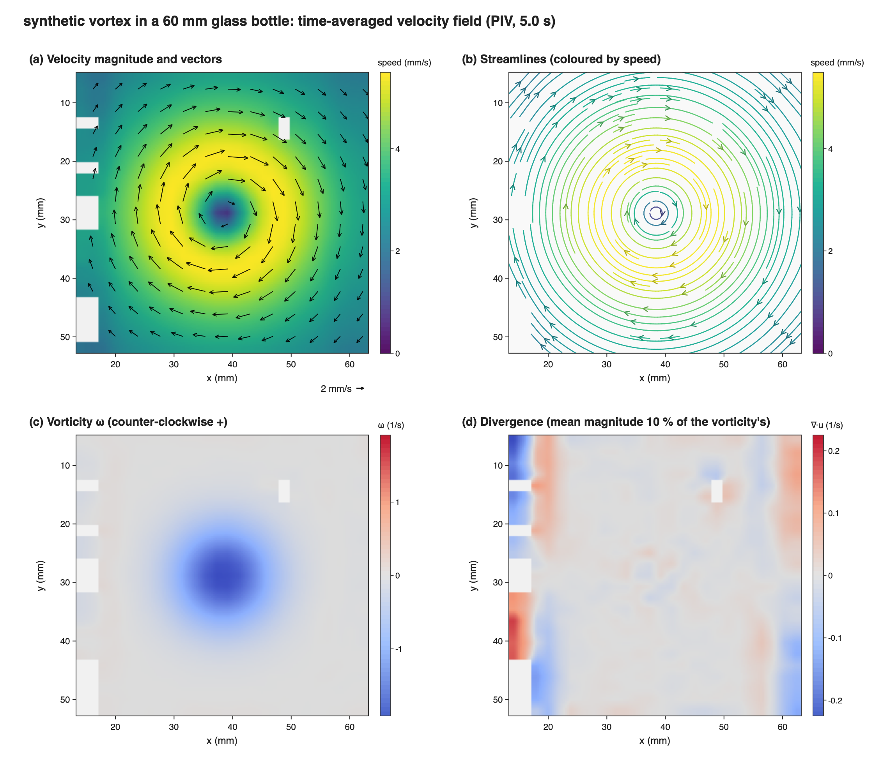
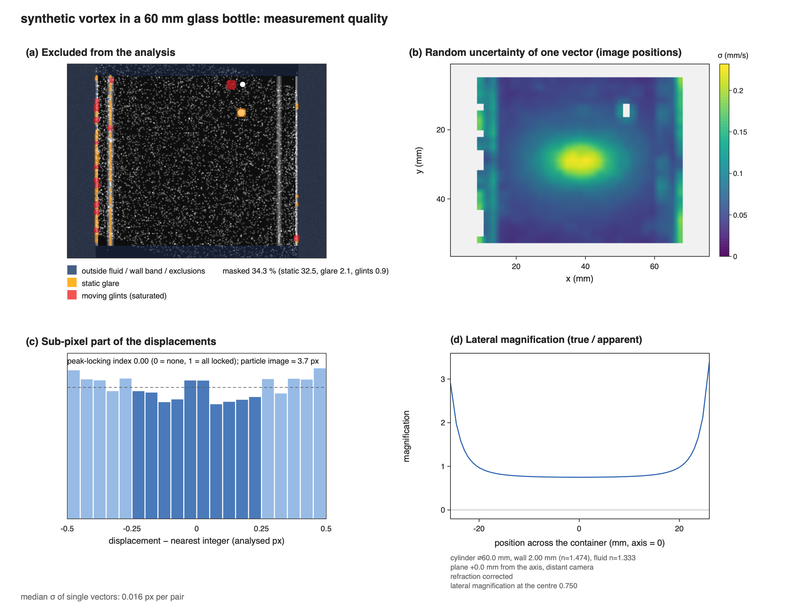

# LivePTV

[](https://github.com/Rhizobium-gits/LivePTV/actions/workflows/ci.yml)


[](LICENSE)

**Real-time particle image velocimetry (PIV) and particle tracking (PTV) on an iPad, with the corrections a real
experiment needs.** A camera looks at a bottle or a tank. LivePTV removes the glass reflections, glare and glints,
undoes the lens effect of the filled container by ray tracing, and reports velocity fields in true plane coordinates.
Every vector comes with its uncertainty, and a methods paragraph is generated for your paper.

日本語の概要は[下](#日本語の概要)にあります。演算の体系（日本語）: [docs/METHODS_ja.md](docs/METHODS_ja.md)

<p align="center">
  
  
</p>

*Synthetic validation case, generated and checked by the tests.* A Lamb–Oseen vortex in water inside a 60 mm glass
bottle, filmed from the side, with reflection stripes on the glass, a saturated hot spot, and a glint travelling along
the free surface. Corrected result: 2.4 % relative RMS error. A naive analysis (mm/px from the bottle diameter, no
corrections) gives 33.8 %. Full output: [docs/examples/synthetic_bottle_piv](docs/examples/synthetic_bottle_piv/), which
includes `report.html` and `methods.txt`.

## What it does

| | |
| --- | --- |
| **Sources** | Insta360 Ace Pro 2 over its own Wi-Fi (community-documented protocol, *not yet verified on hardware*); USB/UVC cameras on iPad and Mac; video files; synthetic flows with known ground truth |
| **PIV** | Multi-pass FFT cross-correlation (64 → 32 px), symmetric sub-pixel window offset with an 8-tap Lanczos kernel, overlap-unbiased 3-point Gaussian peak fit, correlation threshold, normalised median test, flagged replacement, adaptive pair spacing for slow flows |
| **Uncertainty** | Random uncertainty of every vector from correlation statistics (validated: predicted/actual 0.82–1.10); noise-corrected fluctuations; standard errors of the mean |
| **Scene corrections** | Running-mean background removal (reflections, labels, scratches); static-glare and moving-glint masks; user exclusions; camera-shake compensation measured on the raw frames |
| **Containers** | Round bottles and flat tanks: 3-D ray tracing through wall and fluid (Snell's law), length scale from the bottle silhouette, wall band masked, displacements mapped end to end, results resampled on a regular grid in true coordinates |
| **Also** | Ensemble correlation (µPIV), PTV with Brownian diffusion and Stokes–Einstein size, particle-image diameter and peak-locking diagnostics |
| **Outputs** | Self-contained `report.html`, `methods.txt`, publication figures (PNG + vector PDF), CSV, VTK (ParaView), raw per-frame records, bit-exact preview stream |

How every number is computed, why, and how it was validated: **[docs/METHODS.md](docs/METHODS.md)** (English) /
**[docs/METHODS_ja.md](docs/METHODS_ja.md)** (日本語).

## Validation (all asserted by `./scripts/test.sh`)

| Case | Result |
| --- | --- |
| Vortex in a 60 mm bottle with reflections and glints, end to end | 2.4 % error (naive 33.8 %) |
| Reflection stripe + hot spot + moving glint over a uniform flow | RMS 0.158 → 0.024 px; outliers 1.8 % → 0 % |
| Uniform flow imaged through a 56 mm bottle | 0.451 → 0.046 px |
| Ray tracer vs closed-form optics | ≤ 1.2·10⁻⁴ mm; centre magnification 0.7502 = 1/n |
| Single-vector uncertainty vs actual error | ratio 0.82–1.10 over noise, size and out-of-plane loss |
| Sub-pixel bias of aligned windows | bilinear 0.053 px → Lanczos-4 0.002 px |
| Ensemble correlation, faint sparse vortex | 8.5 % vs 11.8 % (vector average); 99 % valid |
| Brownian diffusion coefficient | within 4 % |

## Measuring a flow in a bottle

1. Fill and seed the bottle (or use the turbidity of the fluid itself). Fix the camera on a stand, perpendicular to
   the bottle, and use the camera's linear (distortion-corrected) mode. A light sheet through the axis defines the
   measurement plane best.
2. In the app, choose the source and start the preview.
3. **Container → Round bottle**, then **Mark container outline**. Drag from one outer edge of the bottle to the other,
   from just below the free surface to just above the base.
4. In *Analysis settings › Container and refraction*, enter the outer diameter, the wall thickness and the materials
   (presets for glass, PMMA, PET, water, glycerol and more). The length scale now comes from the silhouette.
5. Leave *Background removal* on the running mean. Use **Add exclusion** for labels or reflections that are still
   visible. *Show masked areas* displays what is ignored.
6. **Start recording**, then stop. The session folder contains the evaluation, figures, the methods paragraph and all
   raw data (Files app: *On My iPad › LivePTV › Sessions*).

For a flat-walled tank, calibrate mm/px with a target in the measurement plane. Alternatively, calibrate on the outer
wall, give the camera distance, and enable *calibrated on the outer wall*.

## Getting started

**iPad app (Xcode).** Open `LivePTV.xcodeproj`, choose your team under *Signing & Capabilities* (a free Apple ID
works), select your iPad and run. The scheme builds Release (the analysis needs compiler optimisation).
Step-by-step guide in Japanese: [docs/INSTALL_XCODE_ja.md](docs/INSTALL_XCODE_ja.md).
Without Xcode, `./scripts/make-swiftpm.sh` builds a Swift Playgrounds package that runs on the iPad itself (unoptimised,
about 3× slower).

**As a Swift package.** Add `https://github.com/Rhizobium-gits/LivePTV` and depend on `PTVCore` (algorithms only) or
`LivePTVKit` (sources, pipeline, recording, SwiftUI app):

```swift
import PTVCore

// 🐱 the bottle: outer silhouette marked on the image, 60 mm glass bottle with water
var bottle = ContainerGeometry()
bottle.shape = .cylinder
bottle.outline = PixelROI(x: 70, y: 30, width: 500, height: 420)
bottle.outerDiameterMM = 60
bottle.wallThicknessMM = 2
let map = RefractionMap(geometry: bottle, calibrationMMPerPixel: nil)!

// 🐱 per frame, in time order: background + masks, then PIV between consecutive frames
// 🐱 (a, b: LumaImage, the luma plane of two frames as Float)
let suppressor = ReflectionSuppressor()
let engine = PIVEngine()
let walls = StaticMask.build(width: a.width, height: a.height, originX: 0, originY: 0, scale: 1,
                             exclusions: [], container: map)
let pa = suppressor.process(a, staticMask: walls), pb = suppressor.process(b, staticMask: walls)
if var field = engine.compute(a: engine.prepare(pa.image, mask: pa.mask),
                              b: engine.prepare(pb.image, mask: pb.mask), dt: 1.0 / 30) {
    map.correct(&field)            // 🐱 true displacements in the measurement plane
    // field.dx / field.dy (px per pair) × map.mmPerPixel → mm; field.sigmaX / sigmaY: uncertainty
}
```

**Tests and tools on a Mac** (Command Line Tools are enough):

```sh
./scripts/test.sh                                     # 98 tests: algorithms, optics, end-to-end recordings, protocol
cd LivePTVKit
swift run -c release ace-probe benchmark --width 1280 --height 720
swift run -c release ace-probe probe --seconds 20     # Mac joined to the camera Wi-Fi: hardware check
```

## Repository layout

| Path | What |
| --- | --- |
| `LivePTVKit/Sources/PTVCore` | Algorithms: PIV engine, uncertainty, ensemble correlation, background and masks, refraction (ray tracing), shake compensation, PTV detector and tracker, statistics |
| `LivePTVKit/Sources/Pipeline` | Frame pipeline, recording, end-of-measurement evaluation, figures, report, VTK |
| `LivePTVKit/Sources/CameraKit` | Camera sources (Insta360 Wi-Fi client, USB, files, synthetic), H.264/H.265 decoding |
| `LivePTVKit/Sources/LivePTVUI` | SwiftUI app (live view, settings, sessions) |
| `LivePTVKit/Sources/ace-probe` | Mac command line: camera verification, benchmark, USB live analysis |
| `LivePTVKit/Tests` | 98 tests, including the validation cases above |
| `App/`, `LivePTV.xcodeproj`, `project.yml` | iPad app shell (XcodeGen); the package lives in `LivePTVKit/` because Xcode cannot use the project's own folder as a local package |
| `Package.swift` | Root manifest so the repository can be added by URL |
| `docs/` | [METHODS](docs/METHODS.md), [Japanese methods](docs/METHODS_ja.md), [camera integration report](docs/TECHNICAL_REPORT.md), [Xcode guide (ja)](docs/INSTALL_XCODE_ja.md), example sessions |
| `scripts/` | `test.sh`, `pack.sh` (zip for another Mac), `make-swiftpm.sh` (Swift Playgrounds), `mock_camera.py` |

## Session data

Each recording folder holds:
- `session.json`: every setting, the camera, the calibration and the clock anchor;
- per-frame records (`frames.csv`, `particles.csv`, `velocities.csv`, `field.csv`, `piv_vectors.csv` with
  per-vector uncertainty and status valid / replaced / invalid / masked);
- the received preview stream, bit-exact;
- the evaluation: `report.html`, `evaluation.json`, `methods.txt`, `mean_field.csv` (rectified when a container is
  set), `mean_field.vtk`, and the figures `figure_summary`, `figure_quality`, `figure_profiles`, `figure_timeseries`
  and `figure_ensemble`.

The details are in [docs/METHODS.md §16](docs/METHODS.md#16-outputs).

## Status and limitations

- The Insta360 Ace Pro 2 Wi-Fi protocol is community-documented and tested only against a protocol-accurate mock
  camera. Verify it with `ace-probe` before relying on it ([camera report](docs/TECHNICAL_REPORT.md), §9). USB cameras work.
- Refraction is corrected for one measurement plane. With volume illumination of turbid fluid, the image is
  depth-averaged. See [METHODS §18](docs/METHODS.md#18-limitations-and-recommendations) for this and the other
  assumptions: optical axis, lens distortion, temperature-dependent refractive indices.
- Velocities use camera timestamps. The live preview is compressed; keep the camera's own recording for re-analysis.

## 日本語の概要

LivePTV は、カメラ映像から流れ場を iPad 上でリアルタイムに計測する PIV/PTV アプリとライブラリです。瓶や水槽越しに撮影する実験で問題になる次の誤差を補正します。

- **瓶の反射・ラベル・傷**: 時間平均の背景を差し引いて除去します。
- **映り込みの強い部分（グレア）と、水面のきらめき**: 自動でマスクします。それ以外に除外したい場所は、画面上で手で指定できます。
- **丸い瓶のレンズ効果**: 水を入れた円筒は、中心付近で幅を約 1.33 倍に、壁際ではそれ以上に引き伸ばして見せます。カメラからの光線を壁と液体の中で屈折させて追跡し（スネルの法則）、測定面上の本当の位置と速度に直します。長さの尺度は瓶の外径とその見かけの幅から決まります。
- **カメラの揺れ**: 静止部分から推定して差し引きます。

すべてのベクトルに不確かさ（相関統計による推定）が付きます。記録を止めると、図（PNG とベクター PDF）、レポート、論文用の手法説明文、CSV、VTK が自動で保存されます。合成データによる検証では、反射と水面のきらめきがある 60 mm ガラス瓶の中の渦を誤差 2.4 % で再現しました。補正なしの解析では 33.8 % でした。

- 演算の体系と検証の詳細: [docs/METHODS_ja.md](docs/METHODS_ja.md)
- iPad へのインストール手順: [docs/INSTALL_XCODE_ja.md](docs/INSTALL_XCODE_ja.md)
- 瓶で測る手順は、上の「Measuring a flow in a bottle」と同じです。

## Citation and license

If you use LivePTV in published work, please cite it ([CITATION.cff](CITATION.cff)) and the method papers listed in
[METHODS §19](docs/METHODS.md#19-references). MIT License, see [LICENSE](LICENSE).
