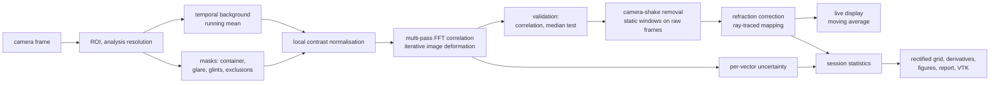

# LivePTV: methods and computational framework

Version 0.8 (unreleased). This document describes every computation between a camera frame and a published number:
what is computed, why it is done that way, and what the validation shows. All numbers quoted as "measured" come
from the automated tests in `LivePTVKit/Tests` (`./scripts/test.sh`), which assert them.

Contents

1. [Coordinates, units and time](#1-coordinates-units-and-time)
2. [Processing chain](#2-processing-chain)
3. [What the camera sees: image model](#3-what-the-camera-sees-image-model)
4. [Temporal background removal](#4-temporal-background-removal)
5. [Masks: container, glare, glints, exclusions](#5-masks-container-glare-glints-exclusions)
6. [Image pre-processing](#6-image-pre-processing)
7. [PIV: cross-correlation](#7-piv-cross-correlation)
8. [Single-vector uncertainty](#8-single-vector-uncertainty)
9. [Particle-image diameter and peak locking](#9-particle-image-diameter-and-peak-locking)
10. [Camera-shake compensation](#10-camera-shake-compensation)
11. [Refraction by the container](#11-refraction-by-the-container)
12. [Ensemble correlation](#12-ensemble-correlation)
13. [Temporal statistics](#13-temporal-statistics)
14. [Derived quantities](#14-derived-quantities)
15. [PTV and Brownian diffusion](#15-ptv-and-brownian-diffusion)
16. [Outputs](#16-outputs)
17. [Validation summary](#17-validation-summary)
18. [Limitations and recommendations](#18-limitations-and-recommendations)
19. [References](#19-references)

---

## 1. Coordinates, units and time

| Frame | Definition | Used for |
| --- | --- | --- |
| Full-frame image px | $(x, y)$, $x$ right, $y$ down, pixel centres at integers, origin at the top-left pixel | Positions as seen by the camera; drawing on the image |
| Analysed px | The region of interest (ROI) at resolution divisor $s \in \{1,2,4\}$; pixel $i$ covers full-frame centre $x_0 + (i+\tfrac12)s - \tfrac12$ | All image processing |
| True plane px | Position in the measurement plane divided by the length scale $\ell$ (mm/px) | Velocities, statistics, figures when a container is set |
| Physical | mm, mm/s or µm/s: px × $\ell$ | Reports |

Without a container, true plane px are the image px and $\ell$ is the entered calibration. With a round container,
$\ell$ follows from the bottle silhouette (§11) and positions and displacements are mapped into the plane.

Velocities always use **camera timestamps** (presentation times from the stream), never Wi-Fi arrival times, unless
the user allows that explicitly; each frame records which timing was used. A PIV pair consists of frame $i$ and the
camera frame $i-k$; its interval is $\Delta t = t_i - t_{i-k}$ from the timestamps. The pair spacing $k$ adapts so the
typical displacement is about 2 analysed px and the largest stays below a quarter window.

Vorticity is reported with the y-up convention (positive = counter-clockwise on screen):
$\omega = \partial u/\partial y_\text{img} - \partial v/\partial x$ in image coordinates.

## 2. Processing chain

Each frame is pre-processed once and reused as the earlier frame of a later pair. The background model learns
only from frames in time order.

## 3. What the camera sees: image model

A frame of a bottle filled with seeded or turbid fluid is modelled as

$$
I(\mathbf{x}, t) = g\Big( B(\mathbf{x}) + T\big(\mathbf{M}^{-1}(\mathbf{x}) , t\big) + G(\mathbf{x}, t) + n(\mathbf{x}, t) \Big)
$$

| Term | Meaning | Treatment |
| --- | --- | --- |
| $B$ | Static scene: reflections on the glass, labels, scratches, the wall rims, uneven light | Temporal background removal (§4); static glare mask (§5) |
| $T$ | Tracer or turbidity pattern in the measurement plane, carried by the flow | What is measured |
| $\mathbf{M}$ | Mapping from the measurement plane to the image: lens of the filled container | Ray-traced refraction correction (§11) |
| $G$ | Moving glints: free-surface sparkle, bubbles | Saturated-blob mask (§5) |
| $n$ | Sensor and compression noise | Random error, quantified per vector (§8) |
| $g$ | Camera response, clipping at 0 and 255 | Saturation handling (§5) |
| (global) | Camera shake moves everything | Shake compensation (§10) |

If these terms are not removed, a static reflection correlates perfectly with itself at zero displacement. That
pulls vectors towards zero. Moving glints drag vectors along with them, and the bottle's lens effect scales
lateral velocities by up to the refractive index near the axis and by much more near the walls.

## 4. Temporal background removal

For each analysed pixel a background $\hat B$ is learned from the frames in time order, and the correlation uses
the signed difference.

**Running mean (default).** With memory $N$ frames (default 300):

$$
\hat B_{t} = \hat B_{t-1} + r_t\,(I_t - \hat B_{t-1}), \qquad r_t = \max\!\big(1/N,\; 1/(n_t+1)\big),
$$

where $n_t$ is the number of frames seen. While fewer than 30 frames have been seen, the raw frame is used. During
that warm-up, the cumulative mean still contains individual tracers, which would come back as negative ghosts
weighted $1/n_t$. The foreground is $F_t = I_t - \hat B_{t-1}$.

**Envelopes (options).** Lower envelope for bright tracers, upper envelope for dark tracers on a back-lit
background. The envelope follows the image slowly ($1/N$ per frame) towards the tracer side and fast (0.5) away
from it, starting from a grey-scale opening (or closing) of the first frame with radius 2 px, which removes
tracer images:

$$
\hat B_t = \hat B_{t-1} + r_\uparrow\,\max(d,0) + r_\downarrow\,\min(d,0), \quad d = I_t - \hat B_{t-1},
$$

with $(r_\uparrow, r_\downarrow) = (1/N, 0.5)$ for the lower envelope and $(0.5, 1/N)$ for the upper envelope.

**Why the mean is the default, and why the difference is not clipped.** The envelope of noisy pixels is an
extreme-value statistic. It leaves a weak static noise pattern in $\hat B$, and that pattern correlates at zero
displacement. Clipping $F$ at zero is a non-linearity that removes half of the noise distribution.

Measured on faint, sparse Brownian tracers in a vortex (120 frames, ensemble correlation), as relative RMS error of
the ensemble field:

| Background | Error |
| --- | --- |
| none | 8.6 % |
| running mean | 8.7 % |
| lower envelope, signed | 10.0 % |
| lower envelope, clipped | 9.6–10.0 % |

On a scene with a static reflection stripe, a hot spot and a moving glint (§17), the corrections reduce the RMS
error of single-pair vectors from 0.158 px to 0.024 px.

## 5. Masks: container, glare, glints, exclusions

A mask $m(\mathbf{x}) \in \{0, 1\}$ (1 = usable) is the product of four parts.

1. **Static mask.** Pixels outside the fluid or inside the wall band of the container (§11), and user-drawn
   exclusion rectangles. It is computed once per geometry.
2. **Static glare.** $\hat B(\mathbf{x}) \ge \max(L_g,\ \operatorname{median}\hat B + \Delta_g)$, by default
   $L_g = 200$ and $\Delta_g = 60$ grey levels. This is refreshed every 10 frames. In such areas particles have
   little contrast left and shot noise is high. The rule is relative to the median, so a uniformly bright back-lit
   background is not masked.
3. **Moving glints.** A pixel counts if $I \ge L_s$ (250) where the background is not itself saturated
   ($\hat B < L_s - 10$). Only blob cores are kept: at least half of the surrounding 5×5 neighbourhood must
   qualify. Single bright tracers survive; free-surface sparkle and bubbles do not. This is evaluated per frame.
4. Glare and glint masks are **dilated** by 3 full-frame px (halo, blooming), using a box filter and a threshold.

Masked pixels are first replaced by the mean of the usable pixels, so a bright edge cannot leak into the local
normalisation around it (§6). After pre-processing they are set to zero, so they add nothing to any correlation.
Window by window, the usable share is a box average of $m_A m_B$ over the window. A window with more than 40 % of
its pixels masked gets the status **masked**: no vector, no median test, no replacement, no statistics.

## 6. Image pre-processing

**Local contrast normalisation** (default, box radius $R = 12$ analysed px):

$$
P = 32\,\frac{F - \mu_R}{\sigma_R + 2}, \qquad \mu_R = \langle F\rangle_R,\quad \sigma_R^2 = \langle F^2\rangle_R - \mu_R^2,
$$

computed with separable box sums. It evens out lighting gradients, vignetting, haze and turbidity. The constant 2
(grey levels, about the sensor noise) stops flat areas from being amplified into noise patterns. The factor 32
restores a grey-level-like range, so contrast thresholds keep their meaning.

**Intensity capping** (clipping at mean + 2σ) is off by default. On faint, sparse images σ is mostly noise, so the
cap clips the particles themselves. Measured on 18 difficult image pairs: RMS error 0.205 px with capping, against
0.177 px for normalisation without capping and 0.161 px for high-pass filtering only.

## 7. PIV: cross-correlation

### 7.1 Correlation

For windows $A, B$ of size $n \times n$ with means removed, the normalised cyclic cross-correlation is computed by
FFT (both windows packed into one complex FFT):

$$
C(\mathbf{s}) = \frac{\sum_{\mathbf{x}} A'(\mathbf{x})\,B'(\mathbf{x}+\mathbf{s})}{n^2\,\sigma_A\,\sigma_B}
 = \frac{\mathcal{F}^{-1}\{\overline{\mathcal{F}A'}\cdot\mathcal{F}B'\}}{n^2\sigma_A\sigma_B}.
$$

$C = 1$ means perfect correlation. A window whose intensity standard deviation is below 1.5 grey levels carries no
pattern and is invalid.

**Where it runs.** The 32-px passes are computed on the GPU when the device has one of Apple GPU family 7 or later
(Mac family 2) that passes a self-check at start-up (a particle image with a known integer shift, for each window
fill); other window sizes, older GPUs and the setting *Correlate on the GPU* off use the CPU (Accelerate). One GPU
threadgroup processes one window pair: window fill (integer copy, bilinear or Lanczos-4, chosen per window by the
same rule as on the CPU), mean and σ, the single-vector uncertainty of §8, the 2-D FFT of $Z = A' + iB'$ in registers
(32-lane SIMD groups), the cross power and the inverse FFT, and the first index of the maximum. The GPU returns the
peak value and its four cyclic neighbours, and the sub-pixel fit of §7.3 runs on the CPU in double precision with the
same code as the CPU path. Fast math is off. On the same frames the two paths give identical statuses, vectors within
6·10⁻⁷ px and uncertainties within 0.01 % (`GPUCorrelationTests`). The window placement, validation and replacement
are shared.

### 7.2 Multi-pass with iterative image deformation

The default passes are 64 px, then 32 px three times (`finalIterations` 3); the final passes have 50 % overlap.
A window covering pixels $x_0 \dots x_0+n-1$ has its centre, and its vector, at $x_0 + (n-1)/2$ (before 0.8 the
vector was reported at $x_0 + n/2$, 0.5 px off, a bias of 0.5 px × the local gradient).

**Deformation (default since 0.8; Scarano 2002).** Each pass after the first takes the previous field as predictor
$\mathbf{d}_p(\mathbf{x})$ and resamples both frames with it, symmetrically (central difference):

$$
A'(\mathbf{x}) = A\big(\mathbf{x} - \tfrac12\mathbf{d}_p(\mathbf{x})\big), \qquad B'(\mathbf{x}) = B\big(\mathbf{x} + \tfrac12\mathbf{d}_p(\mathbf{x})\big).
$$

The windows are then copied from $A'$ and $B'$ at their nominal integer positions and correlated; the residual peak
$\mathbf{r}$ is added to the predictor at the window centre, $\mathbf{d} = \mathbf{d}_p(\mathbf{x}_c) + \mathbf{r}$.
Because the windows follow the velocity gradients inside them, the spatial response is no longer that of a top-hat
average over the window. How the predictor is built matters as much as the deformation itself:

1. **Every cell gets a value.** Masked cells and invalid cells without a replacement are filled with the median of
   their measured neighbours, ring by ring from the measured cells (`ImageDeformation.filledEverywhere`). Left at 0, a
   masked cell bent the deformation of its neighbours: RMS error next to a glare stripe 0.046 → 0.117 px over three
   iterations, 0.050 px after the fix.
2. **Noise-adaptive filter.** The predictor's noise partly propagates (its centre value is added to a residual
   measured over the window). Both a 3 × 3 binomial filter $s_1$ and its square $s_2$ (≈ 5 × 5) are computed; where
   $|s_1 - s_2|$ is within what noise explains (0.3–0.6 $\sigma_n$, $\sigma_n$ the robust spread of the residuals to the
   neighbour medians) the smoother $s_2$ is used, elsewhere $s_1$. Without any filter, structures near the grid's
   Nyquist limit are amplified from one iteration to the next (Schrijer & Scarano 2008). The filter can be switched off
   (*Smooth the predictor*) for finer detail at the price of about twice the random error.
3. **Cubic interpolation between vectors.** The predictor is interpolated to every pixel by Keys cubic convolution,
   on a node grid extended by four ghost nodes per side by linear extrapolation. Bilinear interpolation cuts the
   curvature of the field between nodes, so the deformation removes less than the predictor value at the node and
   the iteration converges above 1: measured +3 % amplitude at λ = 5 windows, as the model
   $\mathrm{sinc}(2h/\lambda)/\cos^2(\pi h/\lambda)$ predicts ($h$ = vector spacing). Holding the field constant
   beyond the outermost window centres (instead of extrapolating) biased edge vectors in a shear flow by ≈ 3 px of
   position.
4. **Gate.** If fewer than half of the previous pass's (unmasked) vectors are valid, the pass shifts windows instead
   of deforming (§ below): resampling both frames with a field that is mostly filler destroyed more correlation than a
   single window offset (very faint, sparse images; use ensemble correlation there, §12).

The frames are resampled with the 8-tap Lanczos kernel below (bilinear if selected); reads outside the image take the
border pixel. CPU and GPU do the same arithmetic in the same order, with the Lanczos weights from one table at
1/4096-px phase steps (≤ 1.2·10⁻⁴ px from the exact phase); the GPU checks at start-up that its deformed frames are
bit-identical to the CPU's.

Measured (`DeformationTests`, synthetic pairs, 2.6-px particle images):

| Test | Window shift (≤ 0.7) | Deformation |
| --- | --- | --- |
| Amplitude of a sinusoid, λ = 64 px = 2 windows | 0.72 (top-hat: 0.64) | 0.84 |
| Same, λ = 160 px | 0.94 | 1.00 |
| Lamb–Oseen vortex, core 30 px, 4 px peak: RMS error | 0.104 px | 0.022 px |
| Uniform flow: RMS error | 0.0059 px | 0.0066 px |
| 18 faint, difficult image pairs (uniform flow): valid / RMS | 88.5 % / 0.175 px | 87.0 % / 0.189 px |

The last two rows are the price: without gradients to resolve there is nothing to gain, and the predictor's noise
adds a little. In flows with gradients deformation wins by a factor of 2–5.

**Window shift (option, and the predictor pass).** With *Window deformation* off, and in a pass the gate stops,
window A is placed at $\mathbf{x}_c - \mathbf{s}_p/2$ and window B at $\mathbf{x}_c + \mathbf{s}_p/2$, with
$\mathbf{s}_p$ the predictor at the window centre; the measured displacement is $\mathbf{s}_p + \mathbf{r}$. A window
pair moves inward only as far as it must to fit in the image (before 0.8 edge windows were measured 3–5 px further
in, at the margins the 8-tap kernel needs, but reported at the edge); where the 8-tap kernel would read outside the
image, that window is interpolated bilinearly. The response of a shifted window is close to a top-hat average,
$\mathrm{sinc}(n/\lambda)$.

**Interpolation.** The final passes use an **8-tap Lanczos (windowed-sinc) kernel**,

$$
L_4(x) = \operatorname{sinc}(x)\,\operatorname{sinc}(x/4),\ |x|<4,
$$

with weights normalised to sum 1. The predictor passes use bilinear interpolation.

The reason is a systematic error found during this work. Bilinear and Keys bicubic kernels are asymmetric at a
fractional phase $t$. Windows A and B are sampled at phases $t$ and $1-t$, so their kernels are mirror images. The
cross-correlation of the two kernels is skewed, which shifts the fitted peak of perfectly aligned windows.
Iterating cannot remove this, because the bias sits at the fixed point.

Measured residual of aligned windows (noise-free, 3.2 px particle images, worst case over sub-pixel shifts):

| Interpolation | Residual |
| --- | --- |
| bilinear | 0.053 px |
| Keys bicubic | 0.061 px |
| Lanczos-3 | 0.005 px |
| Lanczos-4 | 0.002 px |
| integer offsets only | 0.021–0.06 px (peak-locking pattern) |

On complete PIV of noisy synthetic pairs, the actual error fell from 0.040 px to 0.006 px. The price is that the
sinc kernel does not smooth noise as bilinear does: on extremely faint images fewer vectors pass, while the bias falls
from 0.016 px to 0.003 px. For time-averaged fields the bias is what remains, so Lanczos-4 is the default; bilinear can
be selected.

### 7.3 Sub-pixel peak

The integer peak position $(i, j)$ is refined by a 3-point Gaussian fit in each direction. The neighbours are first
divided by the window overlap $n - |s|$ (Westerweel 1997), which removes the bias of the finite-window
correlation towards zero:

$$
\varepsilon = \frac{\ln \tilde C_{-1} - \ln \tilde C_{+1}}{2\,(\ln \tilde C_{-1} - 2\ln \tilde C_0 + \ln \tilde C_{+1})},
\qquad \tilde C_k = \frac{C_{i+k}}{n-|i+k|}.
$$

### 7.4 Validation

1. **Correlation threshold.** Peak $C \ge 0.2$. Pure noise in a 32×32 window peaks at about 0.11, so 0.2 is about
   6σ above chance.
2. **Quarter-window rule.** The residual $|\mathbf{r}|$ must be below $n/4 + 1$.
3. **Normalised median test** (Westerweel & Scarano 2005) on the 8 neighbours (on the grid border the 5 × 5 block,
   see below), threshold 2, $\varepsilon = 0.1$ px:
   $$ r_0 = \frac{|u_0 - u_m|}{r_m + \varepsilon} > 2 \Rightarrow \text{invalid}, $$
   where $u_m$ is the neighbours' median and $r_m$ the median of their residuals $|u_k - u_m|$.
4. **Replacement.** Invalid vectors are replaced by the median of their valid neighbours and flagged
   **replaced**. They are drawn, but excluded from all statistics. Masked windows are never replaced; for the next
   pass's predictor only, they are filled with the neighbour median.

**Border vectors.** On the border of the vector grid the 3 × 3 neighbours lie on one side only. In a plain linear
gradient their median then sits one gradient step away while the median residual is ≈ 0, so a correct border vector
fails the test: before 0.8, 58–71 % of a correct edge row in a shear flow was replaced (it then sat ≈ 12 px away).
Border cells therefore use the 5 × 5 block, whose median residual is again one gradient step; a real outlier on the
border still fails (`GridKernelTests`).

**Known limit.** The test compares a vector with its neighbours, so it cannot tell a real structure that changes sign
from one vector to the next (wavelengths ≲ 3 vector spacings, i.e. ≲ 1.5 windows) from noise, and replaces some correct
vectors there. Such structures are at the resolution limit anyway; use a smaller window or a higher threshold if they
matter.

Status codes in `piv_vectors.csv`: 0 valid, 1 replaced, 2 invalid, 3 masked.

## 8. Single-vector uncertainty

The random uncertainty of every final vector is estimated from correlation statistics, following Wieneke (2015).
The windows A′ and B′ (zero mean) are already aligned by the predicted displacement. Along one axis:

$$
C_0 = \sum A'B', \quad C_\pm = \sum_{\mathbf{x}} A'(\mathbf{x})\,B'(\mathbf{x}\pm\mathbf{e}),
\quad \Delta S(\mathbf{x}) = A'(\mathbf{x})B'(\mathbf{x}+\mathbf{e}) - A'(\mathbf{x}+\mathbf{e})B'(\mathbf{x}).
$$

Random differences between the two images make the per-pixel contributions $\Delta S$ scatter, and so make the
correlation peak asymmetric. These differences come from noise, tracers entering or leaving the window, and
out-of-plane loss. Particle images span several pixels, so neighbouring contributions are correlated. The variance
of their sum includes covariances within 2 px:

$$
\sigma^2_{\Delta C} = \sum_{\mathbf{x}} \delta(\mathbf{x})^2 + 2\!\!\sum_{\mathbf{l}\in H_2}\sum_{\mathbf{x}} \delta(\mathbf{x})\,\delta(\mathbf{x}+\mathbf{l}),
\qquad \delta = \Delta S - \overline{\Delta S},
$$

where $H_2$ is the half-plane of offsets with $|l_x|, |l_y| \le 2$. Linearising the 3-point Gaussian estimator about
$C_+ = C_- = \bar C$ gives

$$
\sigma_\varepsilon = \frac{\sigma_{\Delta C}}{4\,\bar C\,\ln(C_0/\bar C)} .
$$

The result is in analysed px. It is scaled to full-frame px and then by the local magnification of the refraction
correction.

**Validation** (synthetic pairs, 3,250 vectors each):

| Particle σ (px) | Noise (grey) | Out-of-plane loss | Predicted (px) | Actual (px) | Ratio |
| --- | --- | --- | --- | --- | --- |
| 0.8 | 2 | 0 % | 0.006 | 0.006 | 1.10 |
| 0.8 | 8 | 0 % | 0.019 | 0.020 | 0.96 |
| 0.8 | 16 | 0 % | 0.041 | 0.042 | 0.96 |
| 1.2 | 8 | 0 % | 0.020 | 0.020 | 0.99 |
| 0.8 | 4 | 25 % | 0.052 | 0.058 | 0.90 |
| 1.2 | 4 | 25 % | 0.089 | 0.108 | 0.82 |

The test requires agreement within a factor of 1.5. The method covers **random** error only: bias (§7.2) and
unresolved gradients within a window are not included. Before the Lanczos change the actual error at low noise was
dominated by interpolation bias, and the ratio was 0.21. That is how the bias was found.

**Use in statistics.** Each cell reports $\sigma_\text{meas}$, the RMS single-sample uncertainty in px/s, and the
noise-corrected fluctuation $\sqrt{\max(0,\ u'^2_\text{rms} - \sigma^2_\text{meas})}$. The quality figure maps the
share $\sigma^2_\text{meas}/u'^2_\text{rms}$ of the measured fluctuation that is just measurement noise.

## 9. Particle-image diameter and peak locking

For a Gaussian peak the second difference of $\ln C$ is $-1/\sigma_c^2$, whatever the sub-pixel position. The
correlation of two Gaussian particle images of standard deviation $\sigma_p$ has $\sigma_c = \sqrt2\,\sigma_p$, so
the $e^{-2}$ image diameter is

$$ d_\tau = 4\sigma_p = 2\sqrt2\,\sigma_c . $$

The median over valid windows is reported. Measured: true 2.8 / 4.0 / 5.6 px gave 2.73 / 3.67 / 4.83 px. Velocity
gradients and pre-processing broaden the peak, so it is an effective diameter.

The **peak-locking index** is computed from the fractional parts $f = d - \operatorname{round}(d)$ of the raw valid
displacements in analysed px:

$$ \mathrm{PLI} = \max\!\big(0,\ 2\,P(|f|<\tfrac14) - 1\big), $$

0 for a uniform distribution and 1 when everything is locked to integers. The histogram is shown in
`figure_quality`. A warning is issued when $d_\tau < 2$ px and PLI > 0.1: in that case, defocus slightly.

## 10. Camera-shake compensation

A camera on a stand does not only shift. A stand sways about its foot, so the picture turns about a point that is
usually far outside it; a camera that tilts adds keystone; a rolling shutter skews a picture that moves during the
read-out. The camera motion of each pair is therefore written, to first order, as a linearised homography about the
grid centre $\mathbf{c}$:

$$ \mathbf{d}(\mathbf{x}) = \mathbf{t} + \mathbf{L}\,\mathbf{r} - \mathbf{r}\,(\mathbf{k}\cdot\mathbf{r}), \qquad \mathbf{r} = \mathbf{x}-\mathbf{c}, \qquad
\mathbf{L} = \begin{pmatrix} \sigma + e_x & \theta + g_x \\ -\theta + g_y & \sigma + e_y \end{pmatrix}, $$

with shift $\mathbf{t}$, rotation $\theta$, zoom $\sigma$, stretch $e_{x,y}$, shear $g_{x,y}$ and keystone $\mathbf{k}$.
A rotation about any point $\mathbf{q}$, inside or outside the frame, is the same rotation about $\mathbf{c}$ plus the
shift $-\theta R_{90}(\mathbf{q}-\mathbf{c})$.

| Model | Parameters | For |
| --- | --- | --- |
| translation | $\mathbf{t}$ (2) | a camera that only shifts |
| similarity | $\mathbf{t}, \theta, \sigma$ (4) | rotation about any point, distance changes |
| affine | $+ e_x, e_y, g_x, g_y$ (6) | rolling-shutter skew, an oblique view |
| perspective | $+ \mathbf{k}$ (8) | a camera tilting on its stand (pitch, yaw) |
| pivot | $\theta, \sigma$ about the learned point $\mathbf{q}$ (2) | a stand swaying about its foot |
| **automatic** (default) | chosen per pair | |

**Fit.** The model is fitted by least squares to **static windows**. A first pass with the similarity model rejects
windows with residuals above 3 robust σ + 0.05 px; the chosen model is fitted, residuals are rejected again, and it is
refitted. A model is only used if the static windows determine it: the smallest eigenvalue of the column-normalised
normal matrix must be at least 0.02 (with static windows on one side of the picture only, the affine and perspective
terms are not determined and are never chosen). In automatic mode the determinable model with the lowest Bayesian
information criterion, $N\ln(\mathrm{RSS}/N + 10^{-4}) + p\ln N$ ($N$ = 2 × windows, $p$ parameters), is chosen per
pair; a requested model the background cannot determine falls back to the richest simpler one it can.

**Pivot.** For every pair with a rotation, the shift a rotation and zoom about a point $\mathbf{q}$ would cause is
$\mathbf{t} = -M(\mathbf{q}-\mathbf{c})$, $M = \begin{pmatrix}\sigma & \theta\\ -\theta & \sigma\end{pmatrix}$. Least squares over
the session gives $\mathbf{q} = \mathbf{c} - \sum M^\top\mathbf{t} / \sum(\sigma^2+\theta^2)$ and the share $R^2$ of the
fitted shifts it explains. Once at least 10 pairs moved the frame corners by ≥ 0.05 px RMS and $R^2 \ge 0.8$, the
point is reported (live status, evaluation, methods paragraph) and the 2-parameter pivot model becomes a candidate.
It stays well determined when the static background is small or on one side, where the 4-parameter similarity
extrapolates poorly. Each pair's own turning point, $\mathbf{c} - M^{-1}\mathbf{t}$, is recorded in `frames.csv`.

A window counts as static when its time-averaged displacement per frame is zero within 3 standard errors and below
0.15 px/frame. Shake goes back and forth, so its average is zero; a slow steady flow has a mean many standard errors
from zero. Alternatively, a user-drawn reference area defines the static windows. Only the oscillating part is
removed: the long-term mean of the fitted motion (all parameters) is not subtracted, so a slow flow can never be taken
for camera motion. The static test itself learns from the fields with the whole motion removed: with only the
oscillating part removed, static windows show the kept mean as a small steady offset and one by one fail the test
(before 0.8 the compensation could switch itself off after about 60 pairs on clean images).

**PTV.** The same compensation corrects particle tracking. Each pair of consecutive frames is cross-correlated in
64-px windows (32 px at half resolution) to find the static windows and the camera motion; the motions are
accumulated per frame, and every particle step has the camera motion between its two frames subtracted at its
position (steps across a missed frame included).

**Interaction with background removal.** The running mean also removes the static texture this fit relies on.
Therefore the static windows are measured again on the **raw** frames, with one Lanczos-shifted pass and the
current vector as offset. They keep those raw measurements as their vectors.

Measured (`CameraMotionTests`, `CameraMotionPipelineTests`; synthetic camera through the full pipeline, steady vortex,
static border):

| Case | Without | With |
| --- | --- | --- |
| Stand swaying about a point 900 px below the picture (0.3 mrad RMS): velocity fluctuation of the static border / of the flow | 13.96 / 5.32 px/s | 1.20 / 1.13 px/s; pivot found at (311, 1357) px, truth (320, 1380) |
| Same, PTV: RMS error of particle velocities | 10.52 px/s | 3.55 px/s |
| Rolling-shutter shear + keystone + shift: static border / flow | 4.87 / 3.56 px/s (similarity model) | 1.46 / 0.88 px/s (automatic: perspective) |
| Pure shift with 0.05-px noise: pairs fitted with affine or perspective | | 0 of 65 (no over-fitting) |

| Background | Rigid-fit residual | Field error |
| --- | --- | --- |
| none | 0.015 px | 4.4 % |
| running mean, without re-measurement | 0.127 px | 5.8 % |
| running mean, with re-measurement | 0.069 px | 4.7 % |

## 11. Refraction by the container

### 11.1 Geometry

A filled round bottle is a cylindrical lens. In the plane perpendicular to the axis, a ray at lateral offset $x'$
(seen from far away) enters the outer surface at incidence $\theta_1 = \arcsin(x'/R_o)$. It refracts into the wall
and again into the fluid, then reaches the measurement plane at a smaller lateral position. Near the axis, for a
thin wall, $x \approx x'/n_f$: lateral distances and velocities look $n_f$ times too large (1.333 for water).
Towards the wall the apparent image is stretched much more (×3 at 0.9 R in the example). Along the axis nothing
changes for a distant camera. Close to the inner wall the camera sees mirror images of tracers in the wall.

The user marks the bottle's **outer silhouette** and sets:
- outer diameter $D_o$ and wall thickness $t$
- refractive indices $n_w$ and $n_f$, with presets: borosilicate 1.474, soda-lime 1.52, PMMA 1.49, PET 1.575, PC 1.586,
  PS 1.59; water 1.333, seawater 1.339, ethanol 1.361, glycerol 1.473
- the plane offset $p$ from the axis towards the camera (0 = light sheet through the axis)
- optionally the camera distance $D$ to the axis

The silhouette fixes the length scale exactly. At the silhouette the rays graze the outer surface and are not
displaced:

$$ \ell = \frac{D_o}{w_\text{px}} \quad\text{(distant camera)},\qquad \ell = \frac{D}{f},\ f = \frac{w_\text{px}/2}{\tan\alpha},\ \sin\alpha = \frac{R_o}{D}\quad\text{(camera at distance } D). $$

For a flat-walled tank, calibrating in the measurement plane needs no correction, only the wall band mask. If the
calibration was made on the outer wall face, the plane's magnification is corrected, which needs the camera
distance.

### 11.2 Ray tracing

The camera ray of an image point is traced in 3-D: $x$ across the axis, $y$ towards the camera, $z$ along the axis.
The camera is either distant (parallel rays) or a pinhole at distance $D$, with the principal point at the
silhouette centre across the axis and at the frame centre along it. At each interface Snell's law is applied in
vector form, with unit normal $\mathbf{n}$ facing the incoming ray and $\eta = n_1/n_2$:

$$ \mathbf{t} = \eta\,\mathbf{d} + \big(\eta\cos\theta_i - \sqrt{1-\eta^2(1-\cos^2\theta_i)}\big)\,\mathbf{n},\qquad \cos\theta_i = -\mathbf{n}\cdot\mathbf{d}. $$

The ray goes through air → wall ($r = R_o$) → fluid ($r = R_i = R_o - t$) → plane $y = p$. Rays that miss the inner
surface (wall only), are totally reflected, or meet the plane outside the fluid are unmapped. The result $(X, Z)$ in
mm becomes true px:

$$ X_\text{px} = x_c + X/\ell, \qquad Z_\text{px} = z_c + Z/\ell \quad (Z_\text{px} = z \text{ for a distant camera}). $$

The mapping is tabulated and interpolated: 1-D across the axis for a distant camera, a 2-D table at about 1/160 of
the outline otherwise. Points within the wall band (default 1 mm inside $R_i$) and outside the outline's axial
extent are masked; the axial extent excludes the free surface and meniscus at the top and the base at the bottom.

### 11.3 Correcting measurements

Each vector at apparent position $\mathbf{x}$ with displacement $\mathbf{d}$ is mapped end to end:

$$ \mathbf{d}_\text{true} = \mathbf{M}(\mathbf{x} + \mathbf{d}/2) - \mathbf{M}(\mathbf{x} - \mathbf{d}/2), $$

and its uncertainty is scaled by the local magnification $\partial M_i/\partial x_i$. This happens after shake
compensation and after automatic pair-spacing adaptation, which both work in image px. PTV samples are corrected in
the same way. The live display draws true velocities at their apparent image positions.

At the end of a recording, the session statistics are kept on the image grid (true velocities at apparent
positions). They are then **rectified**: resampled on a regular grid in true plane coordinates with the same cell
size. Each node is inverted by Newton iteration on the table, then interpolated bilinearly from valid cells; the
nearest cell must be valid and the valid neighbours must carry at least 75 % of the weight. Vorticity and
divergence are recomputed on that grid. Figures, `mean_field.csv` and `mean_field.vtk` use the rectified grid;
`mean_field_image_grid.csv` keeps the image-grid version.

### 11.4 Validation

| Check | Result |
| --- | --- |
| Vector ray tracer vs an independent closed-form angle construction (60 mm bottle, 2 mm wall, planes 0 and 6 mm) | max difference 1.2·10⁻⁴ mm |
| Centre lateral magnification, thin wall, distant camera | 0.7502 (1/n = 0.7502) |
| Axial magnification with the camera 300 mm away vs paraxial $(D-R_o+t/n_w+R_i/n_f)/D$ | 0.9745 vs 0.9745 |
| Flat tank calibrated on the wall vs paraxial $1+(t/n_w+d/n_f)/L$ | 1.0817 vs 1.0817 |
| Uniform flow imaged through a 56 mm bottle: PIV error without / with correction | 0.451 px / 0.046 px |
| Lamb–Oseen vortex in a 60 mm glass bottle with reflections, hot spot and free-surface glint (150 frames, end to end): relative RMS error of the mean field | corrected 2.4 %; naive (diameter-based mm/px, no corrections) 33.8 % |

## 12. Ensemble correlation

For steady or slowly changing flows with faint, sparse or Brownian tracers (µPIV practice), the correlation
planes of many pairs are averaged per window and the peak is taken from the average (Meinhart, Wereley & Santiago
2000). Random pairings and noise average out of the plane, while the mean displacement peak adds up.

- Windows use fixed integer offsets, so planes add coherently; they are re-centred on the result while not recording.
- Each pair's camera-shake displacement is applied to the second window.
- Live display: exponential average over the last $N$ pairs (default 60). Recording: plain sum over all pairs, with
  the pair spacing fixed.
- A window is valid when its peak ratio (highest ÷ second-highest peak) is at least 1.3 and it has at least 5 pairs.
- Masks and refraction correction are applied to the ensemble field as to single pairs.

Measured end to end (faint sparse vortex, 119 pairs): single pairs 13 % valid; vector average 11.8 % relative
error; ensemble 8.5 %, 99 % valid.

## 13. Temporal statistics

**Live field.** A moving average of the per-pair fields over the averaging window. A cell is shown only if its
vector was valid in at least 30 % of the pairs.

**Session statistics.** These run per cell over the whole recording; flagged samples are excluded:

$$ \bar u = \frac1N\sum u_k,\quad s_u^2 = \frac{1}{N-1}\sum (u_k-\bar u)^2,\quad \overline{u'v'} = \frac{1}{N-1}\sum (u_k-\bar u)(v_k-\bar v), $$
$$ \mathrm{SE}_u = s_u/\sqrt N,\qquad \text{relative uncertainty} = \frac{\sqrt{\mathrm{SE}_u^2+\mathrm{SE}_v^2}}{|\bar{\mathbf u}|},\qquad \mathrm{TI} = \frac{\sqrt{(s_u^2+s_v^2)/2}}{|\bar{\mathbf u}|}. $$

The standard error assumes independent samples. Consecutive PIV pairs of a slow flow are correlated, so treat it
as a lower bound and check the time series (`figure_timeseries`). Pairs taken while shake compensation is still
learning are excluded.

## 14. Derived quantities

- **Vorticity and divergence** use central differences on the (rectified) grid, one-sided next to gaps. In planar
  incompressible flow the divergence should be small; a mean |div| above 50 % of mean |ω| triggers a warning
  about out-of-plane motion, perspective or calibration problems.
- **Streamlines** are evenly spaced (simplified Jobard & Lefer 1997): RK2 integration both ways from grid seeds,
  stopping near existing lines, coloured by speed.
- **Profiles** of u along the vertical centre line and v along the horizontal one, with ±2 SE error bars and a ±1 SD band.

## 15. PTV and Brownian diffusion

**Detection.** Background removal (slow lower envelope), 1-2-1 smoothing, a threshold from robust statistics,
local maxima with non-maximum suppression, then a 3-point Gaussian sub-pixel fit (centroid as fallback). Detections on
masked pixels (glare, glints, walls, exclusions) are discarded.

- *Threshold* $= \max(T_\text{min},\ \ell + k\,\sigma)$, where $\ell$ and $\sigma = 1.4826\,\mathrm{MAD}$ are the median and
  robust spread of the signed, smoothed foreground (from a 1/16-grey-level histogram, O(n)); $k = 5$, $T_\text{min} = 8$.
  The mean and standard deviation of the whole image, used before 0.8, grow with the number and brightness of the
  particles, so the threshold rose with seeding density and lost faint particles; the median and MAD stay at the
  background and its noise while particles cover less than about a quarter of the image. $k$ was chosen so that no
  condition of the detection benchmark falls below 0.997 precision and pure noise gives no detections.
- *Background.* The running background is updated after detection and not under the footprint of this frame's
  detections (above-threshold radius + 2 px). A slowly moving particle otherwise leaks into the background at the
  places it has just occupied; subtracting that ghost pushed the detected centre forward along its motion, which made
  Brownian steps about 20 % too long (D +37 %). Detections that stay within ±1 px for 30 frames are static structures
  and are learned as before.

**Tracking.** Each established track predicts its next position from its velocity (and from its acceleration while
its last two accelerations agree). Candidate links lie within $r = (r_p + 0.1\,|\mathbf{v}|\,\Delta t)(1 + n_\text{missed}/2)$,
$r_p = 4$ px. Tracks and particles are then matched by **global minimum-cost assignment** (cost $|\mathbf{x}-\hat{\mathbf{x}}|^2/r^2$,
leaving a track unmatched costs 1), solved exactly per connected group of candidates by shortest augmenting paths
(Hungarian / Jonker–Volgenant); groups larger than 2000 fall back to closest-first. Tracks without a prediction (the
first frames, new particles) are matched by a **neighbour-consistency vote**: the displacement agreed by most nearby
unmatched particles wins, rather than the nearest particle. New tracks take the median velocity of their 8 nearest
established neighbours. Samples are flagged by a normalised median test against neighbouring samples. Before 0.8
links were made greedily, nearest first, with a fixed 4-px prediction radius.

**Diffusion.** From drift-corrected displacements per cell at lags of one and two frames. With localisation noise
$\sigma$ (Michalet 2010):

$$ \operatorname{var}(\Delta_k) = 2Dk\Delta t + 2\sigma^2 \ \Rightarrow\ D = \frac{\operatorname{var}_2-\operatorname{var}_1}{2\Delta t},\quad \sigma^2 = \frac{2\operatorname{var}_1-\operatorname{var}_2}{2}, $$

with a robust guard against mismatches (6 robust σ). The Stokes–Einstein diameter is
$d_h = k_B T / (3\pi\eta D)$, given when calibrated and $D > 2\,\mathrm{SE}$. Measured: D within 4 % (true 3 px²/s).

Measured (`PTVAccuracyTests`, `AssignmentSolverTests` and the benchmark in `benchmarks/`, against trackpy 0.7):

| Case | LivePTV 0.7 | LivePTV 0.8 | trackpy 0.7 |
| --- | --- | --- | --- |
| Detection recall at 0.01 particles/px, 2.5–4 px images | 0.45–0.53 | 0.76–0.89 | 0.77–0.87 (minimum mass tuned) |
| Detection precision, worst of 12 conditions | 0.990 | 0.997 | 0.983 |
| Links, 5000 particles, 10 px/frame (1.4 spacings): precision / recall | 0.32 / 0.21 | 0.98 / 0.97 | 0.77 / 0.67 |
| Brownian D, synthetic, background removal on: lag 1–2 / 10-lag MSD | +37 % / +26 % | +3 % / +4 % | +5 % / +1 % |
| 1920 × 1080 frame, ~20,000 particles: detect + track | | 52 ms | 0.49 s |

Small particle images (1.5 px) in heavy noise are the exception: recall 0.65 → 0.57 (trackpy 0.58), because the new
threshold no longer sits low enough to catch them; lower k if they matter.

## 16. Outputs

Each recording folder contains raw records (`frames.csv`, `particles.csv`, `velocities.csv`, `field.csv`,
`piv_vectors.csv`, `events.csv`), the bit-exact preview stream, `session.json` (all settings, camera, calibration),
and the end-of-measurement evaluation:

| File | Content |
| --- | --- |
| `evaluation.json` | Every number: measurement, PIV quality (valid/replaced/invalid/masked, uncertainty, particle-image diameter, peak locking), scene corrections, field, diffusion, warnings, verdict |
| `report.html` | Self-contained report with figures and a generated methods paragraph |
| `methods.txt` | A methods paragraph with this session's numbers, for papers and lab notes |
| `mean_field.csv` | Per cell: mean, std, ⟨u′v′⟩, SE, relative uncertainty, TI, ω, div, mm/s columns, x/y in mm, σ_meas, noise-corrected fluctuation (rectified grid when a container is set) |
| `mean_field_image_grid.csv` | The same on the camera-image grid (container only) |
| `mean_field.vtk` | Legacy VTK structured points for ParaView / VisIt |
| `figure_summary` | Speed + vectors, streamlines, vorticity, divergence (PNG + vector PDF) |
| `figure_quality` | Masks over the image, single-vector uncertainty map, sub-pixel histogram, container magnification (or noise share) |
| `figure_profiles`, `figure_timeseries`, `overlay_on_image.png` | Centre-line profiles, steadiness, field over the camera image |
| `ensemble_field.csv`, `figure_ensemble` | Ensemble correlation, when on |

## 17. Validation summary

| Test (file) | Measured |
| --- | --- |
| Bottle scene end to end (`BottleSceneTests`) | 1.9 % vs 34.5 % naive (0.7: 2.4 %), 34 % of windows masked, median σ 0.007 px |
| Reflection stripe + hot spot + moving glint, uniform flow (`ReflectionTests`) | RMS 0.170 → 0.030 px (0.7, window shift: 0.158 → 0.024 px); vectors off by > 0.5 px: 2.2 % → 0 % |
| Ray tracer vs closed form (`RefractionTests`) | ≤ 1.2·10⁻⁴ mm; paraxial checks to 4 digits |
| Uniform flow through a 56 mm bottle, image level (`RefractionTests`) | 0.451 → 0.046 px |
| Single-vector uncertainty (`UncertaintyTests`) | predicted / actual 0.72–0.90 (0.7, window shift: 0.82–1.10) |
| Particle-image diameter (`UncertaintyTests`) | within 14 % for 2.8–5.6 px |
| Window-shift interpolation bias (`WindowShiftInterpolationTests`) | bilinear 0.053 px, Lanczos-4 0.002 px |
| Container plumbing, scale and magnification (`EvaluationTests.containerCorrectionsEndToEnd`) | ℓ = 0.1 mm/px exact; centre speed within 0.3 % of 45 × 0.7502 |
| Camera shake (`EvaluationTests`) | slow vortex kept; shake removed; residual 0.069 px with background removal |
| Camera motion beyond shift (`CameraMotionTests`, `CameraMotionPipelineTests`) | stand sway about a point 900 px below the picture: border fluctuation 13.96 → 1.20 px/s, pivot within 25 px; PTV velocity error 10.52 → 3.55 px/s; shear + keystone: 4.87 → 1.46 px/s vs similarity |
| Ensemble correlation (`EnsembleTests`, `EvaluationTests`) | 8.5 % vs 11.8 % vector average on faint sparse vortex; 99 % valid |
| Brownian diffusion (`SessionStatisticsTests`, `EvaluationTests`, `PTVAccuracyTests`) | D within 4 %; with background removal on +5 % (was +35 %) |
| PTV detection and tracking (`PTVAccuracyTests`, `AssignmentSolverTests`) | dense image recall 1.00 (was 0.44); no detections on pure noise; dense fast flow links 0.97 / 0.96 (was 0.29 / 0.19) |
| GPU vs CPU correlation (`GPUCorrelationTests`) | identical statuses; vectors within 7·10⁻⁵ px with deformation (deformed frames bit-identical), 6·10⁻⁷ px with window shift; σ within 0.1 % |
| Image deformation (`DeformationTests`) | sinusoid λ = 2 windows: amplitude 0.72 → 0.84; λ = 5 windows 1.00 (no overshoot); Lamb–Oseen vortex 0.104 → 0.022 px; uniform flow 0.0059 → 0.0066 px |
| Vector positions and edges (`DeformationTests`, `GridKernelTests`) | position offset 0.5 → < 0.1 px; edge rows in a shear flow: 58–71 % replaced → 0 %, position within 0.3 px |

Speed (Apple M3, 1280×720, PIV 64→32 px, 50 % overlap, release build): 15.1 ms per frame with bilinear shifting
only; 22.0 ms with Lanczos; 24.3 ms with per-vector uncertainty; 26.6 ms with background removal and masks (38 fps).
An unoptimised build (as in Swift Playgrounds) takes 76 ms. The app lowers the analysis resolution automatically
when the live analysis falls below about 8 fps. With the 32-px passes on the GPU (Apple M4, release build, default
settings with background removal, masks and uncertainty): 1920×1080 42.0 ms per frame vs 56.1 ms CPU only, 1280×720
17.0 vs 23.3 ms. The 64-px predictor pass, pre-processing, background removal and masks still run on the CPU.
With image deformation (0.8, three final iterations; synthetic frames, engine only, Apple M4): 1280×720 17.4 ms per
pair (window shift 14.9 ms), 1920×1080 38.8 ms (36.1 ms); CPU only 28.9 and 65.1 ms.

## 18. Limitations and recommendations

- **Illumination defines the measurement plane.** The refraction correction maps rays to *one* plane (the light
  sheet, or the focal plane). With volume illumination, especially of turbid fluid, the image is a depth-weighted
  average along each ray. Rays through a cylinder reach different lateral positions at different depths, so the
  measured velocity is a mixture. Use a light sheet through the axis when you can. Otherwise set the plane offset to
  the depth that dominates and treat lateral velocities near the walls with caution. The depth of correlation of
  volume-illuminated PIV (Olsen & Adrian 2000) is not computed.
- **Turbidity patterns** are correlated like tracers. Large-scale brightness changes, such as a plume getting
  denser, are not motion. The background removal and normalisation suppress them, but strong unsteady turbidity
  gradients remain a source of error. Check the noise-share map in `figure_quality`.
- **Optical assumptions.** The optical axis is assumed to pass through the frame centre, and across the cylinder
  through the silhouette centre. Lens distortion is not modelled: use the camera's linear (distortion-corrected)
  mode. Refractive indices depend on temperature and wavelength (water: −1·10⁻⁴ per K).
- **Index matching** (Budwig 1994) remains the cleanest experimental alternative to numerical correction.
- **Wall band.** Mirror images of tracers in the wall, and the extreme stretching there, are excluded. The usable
  fluid therefore ends about 1 mm (adjustable) inside the inner wall, and further in apparent pixels, since that
  region is magnified ×3 or more.
- **Deformation in uniform, faint flows.** Where there are no gradients to resolve, deformation cannot gain and the
  predictor's noise adds a little (uniform flow 0.0059 → 0.0066 px; 18 faint pairs 0.175 → 0.189 px, valid 88.5 →
  87.0 %). Below half valid vectors a pass falls back to window shift. *Window deformation* can be switched off.
- **Uncertainty with deformation.** The correlation-statistics estimate (§8) sees the residual of the last pass only.
  With deformation, predicted ÷ actual error ranged 0.84–1.48 on the synthetic tests (over-estimated on clean images
  with gradients, under-estimated by ≈ 15 % on noisy ones), against 0.90–1.21 with window shift.
- **Uncertainty.** The per-vector estimate covers random error only. Bias from remaining interpolation error,
  unresolved gradients within a window, out-of-plane motion and calibration is not included.
- **Camera preview.** The live stream from the camera is compressed and lower in quality than its own recording.
  Compression can smear fine particle images; keep the camera's recording for re-analysis.
- **Background and slow tracers.** Tracers that stay put longer than the background memory (300 frames, 10 s at
  30 fps) fade into the background. Raise the memory for very slow flows.

## 19. References

- Adrian, R. J., & Westerweel, J. (2011). *Particle Image Velocimetry*. Cambridge University Press.
- Astarita, T., & Cardone, G. (2005). Analysis of interpolation schemes for image deformation methods in PIV. *Experiments in Fluids*, 38, 233–243. https://doi.org/10.1007/s00348-004-0902-3
- Budwig, R. (1994). Refractive index matching methods for liquid flow investigations. *Experiments in Fluids*, 17, 350–355.
- Christensen, K. T. (2004). The influence of peak-locking errors on turbulence statistics computed from PIV ensembles. *Experiments in Fluids*, 36, 484–497.
- Duchon, C. E. (1979). Lanczos filtering in one and two dimensions. *Journal of Applied Meteorology*, 18, 1016–1022.
- Jobard, B., & Lefer, W. (1997). Creating evenly-spaced streamlines of arbitrary density. In *Visualization in Scientific Computing '97*, Springer.
- Keys, R. G. (1981). Cubic convolution interpolation for digital image processing. *IEEE Transactions on Acoustics, Speech, and Signal Processing*, 29, 1153–1160.
- Lowe, M. L., & Kutt, P. H. (1992). Refraction through cylindrical tubes. *Experiments in Fluids*, 13, 315–320.
- Meinhart, C. D., Wereley, S. T., & Santiago, J. G. (2000). A PIV algorithm for estimating time-averaged velocity fields. *Journal of Fluids Engineering*, 122, 285–289.
- Michalet, X. (2010). Mean square displacement analysis of single-particle trajectories with localization error: Brownian motion in an isotropic medium. *Physical Review E*, 82, 041914. https://doi.org/10.1103/PhysRevE.82.041914
- Olsen, M. G., & Adrian, R. J. (2000). Out-of-focus effects on particle image visibility and correlation in microscopic particle image velocimetry. *Experiments in Fluids*, 29, S166–S174.
- Raffel, M., Willert, C. E., Scarano, F., Kähler, C. J., Wereley, S. T., & Kompenhans, J. (2018). *Particle Image Velocimetry: A Practical Guide* (3rd ed.). Springer.
- Scarano, F. (2002). Iterative image deformation methods in PIV. *Measurement Science and Technology*, 13, R1–R19.
- Schrijer, F. F. J., & Scarano, F. (2008). Effect of predictor–corrector filtering on the stability and spatial resolution of iterative PIV interrogation. *Experiments in Fluids*, 45, 927–941. https://doi.org/10.1007/s00348-008-0511-7
- Thielicke, W., & Stamhuis, E. J. (2014). PIVlab – towards user-friendly, affordable and accurate digital particle image velocimetry in MATLAB. *Journal of Open Research Software*, 2(1), e30.
- Westerweel, J. (1997). Fundamentals of digital particle image velocimetry. *Measurement Science and Technology*, 8, 1379–1392.
- Westerweel, J., & Scarano, F. (2005). Universal outlier detection for PIV data. *Experiments in Fluids*, 39, 1096–1100.
- Wieneke, B. (2015). PIV uncertainty quantification from correlation statistics. *Measurement Science and Technology*, 26, 074002. https://doi.org/10.1088/0957-0233/26/7/074002
