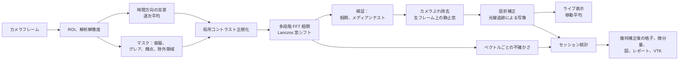

# LivePTV：手法と計算の枠組み

英語版: [METHODS.md](METHODS.md)（内容は同一）

バージョン 0.7（2026-11-24）。本文書は、カメラのフレームから公表される数値に至るまでのすべての計算について、何を計算するのか、なぜその方法をとるのか、検証で何が示されたのかを記述する。本文書で「測定」値として引用する数値はすべて `LivePTVKit/Tests` の自動テスト（`./scripts/test.sh`）から得たものであり、これらのテストはその値を検証（assert）している。

目次

1. [座標、単位、時刻](#1-座標単位時刻)
2. [処理の流れ](#2-処理の流れ)
3. [カメラに写るもの：画像モデル](#3-カメラに写るもの画像モデル)
4. [時間方向の背景除去](#4-時間方向の背景除去)
5. [マスク：容器、グレア、輝点、除外領域](#5-マスク容器グレア輝点除外領域)
6. [画像の前処理](#6-画像の前処理)
7. [PIV：相互相関](#7-piv相互相関)
8. [単一ベクトルの不確かさ](#8-単一ベクトルの不確かさ)
9. [粒子像径とピークロッキング](#9-粒子像径とピークロッキング)
10. [カメラぶれの補正](#10-カメラぶれの補正)
11. [容器による屈折](#11-容器による屈折)
12. [アンサンブル相関](#12-アンサンブル相関)
13. [時間統計](#13-時間統計)
14. [派生量](#14-派生量)
15. [PTV とブラウン拡散](#15-ptv-とブラウン拡散)
16. [出力](#16-出力)
17. [検証のまとめ](#17-検証のまとめ)
18. [制約と推奨事項](#18-制約と推奨事項)
19. [参考文献](#19-参考文献)

---

## 1. 座標、単位、時刻

| 座標系 | 定義 | 用途 |
| --- | --- | --- |
| フルフレーム画像 px | $(x, y)$。$x$ は右向き、$y$ は下向き、画素中心は整数位置、原点は左上の画素 | カメラから見た位置、画像上への描画 |
| 解析 px | 解像度除数 $s \in \{1,2,4\}$ における関心領域（region of interest, ROI）。画素 $i$ はフルフレーム座標で中心 $x_0 + (i+\tfrac12)s - \tfrac12$ の範囲を覆う | すべての画像処理 |
| 真の平面 px | 測定面内の位置を長さスケール $\ell$（mm/px）で割ったもの | 容器を設定した場合の速度、統計量、図 |
| 物理単位 | mm、mm/s または µm/s：px × $\ell$ | レポート |

容器を設定しない場合、真の平面 px は画像 px と一致し、$\ell$ は入力された較正値である。円形の容器を設定した場合、$\ell$ はボトルのシルエットから求まり（§11）、位置と変位は測定面へ写像される。

速度の算出には常に**カメラのタイムスタンプ**（ストリームの提示時刻（presentation time））を用い、ユーザーが明示的に許可しない限り Wi-Fi の到着時刻は用いない。各フレームには、どちらの時刻を用いたかが記録される。PIV のペアはフレーム $i$ とカメラフレーム $i-k$ からなり、その時間間隔はタイムスタンプから $\Delta t = t_i - t_{i-k}$ として求める。ペア間隔 $k$ は、典型的な変位が約 2 解析 px となり、最大の変位が検査窓（interrogation window）の 1/4 未満に収まるように適応的に調整される。

渦度（vorticity）は y 軸上向きの規約（正 = 画面上で反時計回り）で報告する。画像座標では $\omega = \partial u/\partial y_\text{img} - \partial v/\partial x$ である。

## 2. 処理の流れ

各フレームの前処理は 1 回だけ行い、後続のペアでは先行フレームとして再利用する。背景モデルは時間順に並んだフレームからのみ学習する。

## 3. カメラに写るもの：画像モデル

トレーサー粒子を添加した（seeded）流体、あるいは濁った流体で満たしたボトルのフレームを、次のようにモデル化する。

$$
I(\mathbf{x}, t) = g\Big( B(\mathbf{x}) + T\big(\mathbf{M}^{-1}(\mathbf{x}) , t\big) + G(\mathbf{x}, t) + n(\mathbf{x}, t) \Big)
$$

| 項 | 意味 | 処理 |
| --- | --- | --- |
| $B$ | 静止シーン：ガラス面の反射、ラベル、傷、壁の縁、不均一な照明 | 時間方向の背景除去（§4）、静的グレアマスク（§5） |
| $T$ | 測定面内のトレーサーまたは濁りのパターンで、流れによって運ばれるもの | 測定対象 |
| $\mathbf{M}$ | 測定面から画像への写像：液体を満たした容器のレンズ作用 | 光線追跡による屈折補正（§11） |
| $G$ | 移動する輝点（glint）：自由表面のきらめき、気泡 | 飽和ブロブのマスク（§5） |
| $n$ | センサーノイズと圧縮ノイズ | ランダム誤差。ベクトルごとに定量化（§8） |
| $g$ | カメラの応答特性、0 と 255 でのクリッピング | 飽和の扱い（§5） |
| （全体） | カメラぶれによりすべてが動く | ぶれ補正（§10） |

これらの項を除去しないと、静止した反射は変位ゼロで自分自身と完全に相関し、ベクトルをゼロへ引き寄せる。移動する輝点はベクトルを自らの動きに引きずる。また、ボトルのレンズ効果は横方向の速度を、軸付近では最大で屈折率倍に、壁付近ではそれよりはるかに大きく拡大する。

## 4. 時間方向の背景除去

解析画素ごとに、時間順のフレームから背景 $\hat B$ を学習し、相関には符号付きの差分を用いる。

**逐次平均（running mean、既定）。** 記憶長を $N$ フレーム（既定値 300）として、

$$
\hat B_{t} = \hat B_{t-1} + r_t\,(I_t - \hat B_{t-1}), \qquad r_t = \max\!\big(1/N,\; 1/(n_t+1)\big),
$$

とする。ここで $n_t$ はそれまでに処理したフレーム数である。処理済みフレームが 30 未満の間は生フレームをそのまま用いる。このウォームアップ期間中、累積平均には個々のトレーサーがまだ含まれており、それらは重み $1/n_t$ の負のゴーストとして現れることになる。前景は $F_t = I_t - \hat B_{t-1}$ である。

**包絡線（オプション）。** 明るいトレーサーには下側包絡線を、背面照明の背景上の暗いトレーサーには上側包絡線を用いる。包絡線は、トレーサー側へは遅く（1 フレームあたり $1/N$）、その反対側へは速く（0.5）画像に追従する。初期値は、最初のフレームに半径 2 px のグレースケール・オープニング（またはクロージング）を施したものであり、これによりトレーサー像が除去される。

$$
\hat B_t = \hat B_{t-1} + r_\uparrow\,\max(d,0) + r_\downarrow\,\min(d,0), \quad d = I_t - \hat B_{t-1},
$$

ここで、下側包絡線では $(r_\uparrow, r_\downarrow) = (1/N, 0.5)$、上側包絡線では $(0.5, 1/N)$ とする。

**平均を既定とする理由、および差分をクリップしない理由。** ノイズを含む画素の包絡線は極値統計量である。そのため $\hat B$ に弱い静的なノイズパターンが残り、このパターンは変位ゼロで相関する。また、$F$ をゼロでクリップすることは、ノイズ分布の半分を取り除く非線形操作である。

渦の中にある微弱で疎なブラウン運動トレーサー（120 フレーム、アンサンブル相関）について、アンサンブル場の相対 RMS 誤差を測定した結果を示す。

| 背景 | 誤差 |
| --- | --- |
| なし | 8.6 % |
| 逐次平均 | 8.7 % |
| 下側包絡線、符号付き | 10.0 % |
| 下側包絡線、クリップあり | 9.6–10.0 % |

静止した反射の縞、ホットスポット、移動する輝点を含むシーン（§17）では、これらの補正により単一ペアのベクトルの RMS 誤差が 0.158 px から 0.024 px に低減する。

## 5. マスク：容器、グレア、輝点、除外領域

マスク $m(\mathbf{x}) \in \{0, 1\}$（1 = 使用可能）は、以下の 4 つの部分の積である。

1. **静的マスク。** 流体の外側、または容器の壁近傍帯（wall band、§11）内にある画素、およびユーザーが描いた除外矩形。形状設定ごとに 1 回だけ計算する。
2. **静的グレア。** $\hat B(\mathbf{x}) \ge \max(L_g,\ \operatorname{median}\hat B + \Delta_g)$ を満たす画素であり、既定値は $L_g = 200$、$\Delta_g = 60$ 階調である。10 フレームごとに更新する。このような領域では粒子のコントラストがほとんど残らず、ショットノイズも大きい。判定基準は中央値に対する相対値であるため、一様に明るい背面照明の背景はマスクされない。
3. **移動する輝点。** 背景自体が飽和していない（$\hat B < L_s - 10$）位置で $I \ge L_s$（250）となる画素を対象とする。ブロブの中心部のみを残すため、周囲の 5×5 近傍の少なくとも半数がこの条件を満たすことを要件とする。単独の明るいトレーサーは残り、自由表面のきらめきや気泡は残らない。この判定はフレームごとに行う。
4. グレアマスクと輝点マスクは、ボックスフィルタと閾値を用いて、フルフレームで 3 px **膨張**させる（ハロー、ブルーミング）。

マスクされた画素は、まず使用可能な画素の平均値で置き換える。これにより、明るい縁がその周囲の局所正規化（§6）に漏れ込むことを防ぐ。前処理の後、これらの画素はゼロに設定されるため、いかなる相関にも寄与しない。窓ごとの使用可能な割合は、窓内での $m_A m_B$ のボックス平均である。画素の 40 % を超えてマスクされた窓には状態 **masked** を付与し、ベクトルの算出、メディアンテスト、置換、統計のいずれも行わない。

## 6. 画像の前処理

**局所コントラスト正規化**（既定、ボックス半径 $R = 12$ 解析 px）：

$$
P = 32\,\frac{F - \mu_R}{\sigma_R + 2}, \qquad \mu_R = \langle F\rangle_R,\quad \sigma_R^2 = \langle F^2\rangle_R - \mu_R^2,
$$

これは分離可能なボックス和で計算する。照明の勾配、周辺減光（ビネッティング）、かすみ、濁りを均一化する。定数 2（階調単位で、センサーノイズ程度）は、平坦な領域が増幅されてノイズパターンになることを防ぐ。係数 32 は値域を階調値に近い範囲に戻すため、コントラストの閾値がその意味を保つ。

**輝度キャッピング**（平均 + 2σ でのクリッピング）は既定では無効である。微弱で疎な画像では σ の大部分がノイズであるため、キャップが粒子そのものをクリップしてしまう。難しい画像ペア 18 組で測定した RMS 誤差は、キャッピングありで 0.205 px であったのに対し、キャッピングなしの正規化では 0.177 px、ハイパスフィルタのみでは 0.161 px であった。

## 7. PIV：相互相関

### 7.1 相関

平均を差し引いたサイズ $n \times n$ の窓 $A, B$ について、正規化した巡回相互相関（cross-correlation）を FFT で計算する（2 つの窓を 1 回の複素 FFT にまとめて処理する）。

$$
C(\mathbf{s}) = \frac{\sum_{\mathbf{x}} A'(\mathbf{x})\,B'(\mathbf{x}+\mathbf{s})}{n^2\,\sigma_A\,\sigma_B}
 = \frac{\mathcal{F}^{-1}\{\overline{\mathcal{F}A'}\cdot\mathcal{F}B'\}}{n^2\sigma_A\sigma_B}.
$$

$C = 1$ は完全な相関を意味する。輝度の標準偏差が 1.5 階調未満の窓はパターンをもたないため、無効とする。

**計算する場所。** 32 px のパスは、端末の GPU が Apple GPU ファミリー 7 以降（Mac ではファミリー 2）で、起動時の自己診断（既知の整数ずれをもつ粒子画像を、窓の作り方ごとに計算する）に合格した場合に GPU で計算する。ほかの窓サイズ、古い GPU、設定「Correlate on the GPU」がオフの場合は CPU（Accelerate）で計算する。GPU では 1 つのスレッドグループが 1 組の窓を処理する。処理は、窓の作成（整数コピー、双線形、Lanczos-4 のいずれかを CPU と同じ規則で窓ごとに選ぶ）、平均と σ、§8 の単一ベクトルの不確かさ、$Z = A' + iB'$ の 2 次元 FFT（32 レーンの SIMD グループでレジスタ内で計算）、クロスパワーと逆 FFT、最大値の最初の添字である。GPU はピーク値とその巡回 4 近傍を返し、§7.3 のサブピクセル推定は CPU 側で CPU 経路と同じコードにより倍精度で行う。fast math は使わない。同じフレームに対して、両経路の状態は完全に一致し、ベクトルの差は 6·10⁻⁷ px 以内、不確かさの差は 0.01 % 以内である（`GPUCorrelationTests`）。窓の配置、検証、置換は両経路で共通である。

### 7.2 対称なサブピクセル窓オフセットを用いたマルチパス処理

既定のパスは 64 px、次いで 32 px であり、最終段で 2 回の反復を行う。最終パスのオーバーラップは 50 % である。2 回目以降の各パスでは、前のパスで得た場を窓中心で双線形補間したものを予測子 $\mathbf{s}_p$ とする。窓 A は $\mathbf{x}_c - \mathbf{s}_p/2$ に、窓 B は $\mathbf{x}_c + \mathbf{s}_p/2$ に配置する。測定される変位は $\mathbf{s}_p + \mathbf{r}$ であり、$\mathbf{r}$ は残差のピーク位置である。画像の端付近では、両方の窓を一緒に内側へずらす。

**シフトした窓の補間。** 最終パスでは **8 タップの Lanczos（窓関数付き sinc）カーネル**を用いる。

$$
L_4(x) = \operatorname{sinc}(x)\,\operatorname{sinc}(x/4),\ |x|<4,
$$

重みは総和が 1 となるように正規化し、分離可能な形で適用する。予測子を求めるパスでは双線形補間を用いる。

その理由は、本開発の過程で見いだされた系統誤差にある。双線形カーネルと Keys の双三次カーネルは、小数位相 $t$ において非対称である。窓 A と B はそれぞれ位相 $t$ と $1-t$ でサンプリングされるため、両者のカーネルは互いに鏡像となる。2 つのカーネルの相互相関は歪んだ形になり、完全に位置が揃った窓であってもフィットしたピークがずれる。このバイアスは反復の不動点に存在するため、反復によって除去することはできない。

位置の揃った窓における残差の測定値（ノイズなし、粒子像 3.2 px、サブピクセルシフトに対する最悪値）：

| 補間 | 残差 |
| --- | --- |
| 双線形 | 0.053 px |
| Keys 双三次 | 0.061 px |
| Lanczos-3 | 0.005 px |
| Lanczos-4 | 0.002 px |
| 整数オフセットのみ | 0.021–0.06 px（ピークロッキングのパターン） |

ノイズを含む合成画像ペアに対する PIV 処理全体では、実際の誤差が 0.040 px から 0.006 px に低下した。その代償として、sinc カーネルは双線形補間のようにはノイズを平滑化しない。極めて微弱な画像（難しいペア 18 組）では、RMS 誤差が 0.151 px ではなく 0.177 px となり、検証を通過するベクトルも減る。一方で、バイアスは 0.016 px から 0.003 px に低下する。時間平均場で残るのはバイアスであるため、Lanczos-4 を既定とし、双線形補間も選択できるようにしている。

### 7.3 サブピクセルピーク推定

整数のピーク位置 $(i, j)$ を、各方向の 3 点ガウスフィットにより精密化する。その前に、隣接値を窓の重なり $n - |s|$ で割る（Westerweel 1997）。これにより、有限窓の相関に生じるゼロ方向へのバイアスが除去される。

$$
\varepsilon = \frac{\ln \tilde C_{-1} - \ln \tilde C_{+1}}{2\,(\ln \tilde C_{-1} - 2\ln \tilde C_0 + \ln \tilde C_{+1})},
\qquad \tilde C_k = \frac{C_{i+k}}{n-|i+k|}.
$$

### 7.4 ベクトルの検証

1. **相関の閾値。** ピーク $C \ge 0.2$ を要求する。32×32 の窓における純粋なノイズのピークは約 0.11 であり、0.2 は偶然の水準より約 6σ 高い。
2. **1/4 窓則。** 残差 $|\mathbf{r}|$ は $n/4 + 1$ 未満でなければならない。
3. **正規化メディアンテスト**（normalised median test、Westerweel & Scarano 2005）を 8 近傍に対して閾値 2、$\varepsilon = 0.1$ px で適用する。
   $$ r_0 = \frac{|u_0 - u_m|}{r_m + \varepsilon} > 2 \Rightarrow \text{invalid}, $$
   ここで $u_m$ は近傍の中央値、$r_m$ は近傍の残差 $|u_k - u_m|$ の中央値である。
4. **置換。** 無効なベクトルは有効な近傍ベクトルの中央値で置き換え、**replaced** のフラグを付ける。これらは描画されるが、すべての統計から除外される。マスクされた窓は置換しない。ただし、次のパスの予測子に限り、近傍の中央値で埋める。

`piv_vectors.csv` の状態コードは、0 valid（有効）、1 replaced（置換）、2 invalid（無効）、3 masked（マスク）である。

## 8. 単一ベクトルの不確かさ

最終的な各ベクトルのランダムな不確かさ（uncertainty）を、Wieneke (2015) に従い相関統計から推定する。窓 A′ と B′（平均ゼロ）は、予測変位によってすでに位置合わせされている。1 つの軸方向について、

$$
C_0 = \sum A'B', \quad C_\pm = \sum_{\mathbf{x}} A'(\mathbf{x})\,B'(\mathbf{x}\pm\mathbf{e}),
\quad \Delta S(\mathbf{x}) = A'(\mathbf{x})B'(\mathbf{x}+\mathbf{e}) - A'(\mathbf{x}+\mathbf{e})B'(\mathbf{x}).
$$

2 枚の画像間のランダムな差異により画素ごとの寄与 $\Delta S$ がばらつき、その結果として相関ピークが非対称になる。これらの差異は、ノイズ、窓に出入りするトレーサー、面外方向への粒子の損失（out-of-plane loss）に起因する。粒子像は数画素にわたるため、隣接する寄与どうしは相関をもつ。したがって、それらの和の分散には 2 px 以内の共分散を含める。

$$
\sigma^2_{\Delta C} = \sum_{\mathbf{x}} \delta(\mathbf{x})^2 + 2\!\!\sum_{\mathbf{l}\in H_2}\sum_{\mathbf{x}} \delta(\mathbf{x})\,\delta(\mathbf{x}+\mathbf{l}),
\qquad \delta = \Delta S - \overline{\Delta S},
$$

ここで $H_2$ は $|l_x|, |l_y| \le 2$ を満たすオフセットの半平面である。3 点ガウス推定量を $C_+ = C_- = \bar C$ のまわりで線形化すると、次式を得る。

$$
\sigma_\varepsilon = \frac{\sigma_{\Delta C}}{4\,\bar C\,\ln(C_0/\bar C)} .
$$

結果は解析 px 単位である。これをフルフレーム px に換算し、さらに屈折補正の局所倍率でスケーリングする。

**検証**（合成画像ペア、各 3,250 ベクトル）：

| 粒子 σ (px) | ノイズ（階調） | 面外損失 | 予測値 (px) | 実際の値 (px) | 比 |
| --- | --- | --- | --- | --- | --- |
| 0.8 | 2 | 0 % | 0.006 | 0.006 | 1.10 |
| 0.8 | 8 | 0 % | 0.019 | 0.020 | 0.96 |
| 0.8 | 16 | 0 % | 0.041 | 0.042 | 0.96 |
| 1.2 | 8 | 0 % | 0.020 | 0.020 | 0.99 |
| 0.8 | 4 | 25 % | 0.052 | 0.058 | 0.90 |
| 1.2 | 4 | 25 % | 0.089 | 0.108 | 0.82 |

テストでは、両者が 1.5 倍以内で一致することを要求する。本手法が対象とするのは**ランダム**誤差のみであり、バイアス（§7.2）や窓内で解像されない勾配は含まれない。Lanczos への変更以前は、低ノイズ時の実際の誤差は補間バイアスが支配的であり、比は 0.21 であった。このバイアスはこうして発見された。

**統計での利用。** 各セルについて、単一サンプルの不確かさの RMS 値 $\sigma_\text{meas}$（px/s）と、ノイズ補正した変動 $\sqrt{\max(0,\ u'^2_\text{rms} - \sigma^2_\text{meas})}$ を出力する。品質図では、測定された変動のうち単なる測定ノイズにすぎない割合 $\sigma^2_\text{meas}/u'^2_\text{rms}$ をマップとして示す。

## 9. 粒子像径とピークロッキング

ガウス型のピークでは、$\ln C$ の 2 階差分はサブピクセル位置によらず $-1/\sigma_c^2$ となる。標準偏差 $\sigma_p$ の 2 つのガウス型粒子像の相関は $\sigma_c = \sqrt2\,\sigma_p$ をもつので、$e^{-2}$ 粒子像径は次式で与えられる。

$$ d_\tau = 4\sigma_p = 2\sqrt2\,\sigma_c . $$

有効な窓にわたる中央値を報告する。測定結果：真値 2.8 / 4.0 / 5.6 px に対して 2.73 / 3.67 / 4.83 px が得られた。速度勾配と前処理によってピークが広がるため、これは実効的な粒子像径である。

**ピークロッキング指数**（peak-locking index）は、解析 px 単位の生の有効変位の小数部 $f = d - \operatorname{round}(d)$ から計算する。

$$ \mathrm{PLI} = \max\!\big(0,\ 2\,P(|f|<\tfrac14) - 1\big), $$

この値は一様分布で 0、すべてが整数にロックされたとき 1 となる。ヒストグラムは `figure_quality` に示す。$d_\tau < 2$ px かつ PLI > 0.1 のときは警告を出す。その場合は、わずかにピントをずらす（デフォーカスする）とよい。

## 10. カメラぶれの補正

各ペアにおけるカメラの動きを、格子中心 $\mathbf{c}$ まわりの相似変換（平行移動、微小回転 $\theta$、スケール $\sigma$）として表す。

$$ \mathbf{d}(\mathbf{x}) = \mathbf{t} + \sigma(\mathbf{x}-\mathbf{c}) + \theta\,R_{90}(\mathbf{x}-\mathbf{c}). $$

これを**静止窓**に最小二乗法でフィットし、残差が 3 ロバスト σ + 0.05 px を超えるものを棄却した後、再度フィットする。1 フレームあたりの変位の時間平均が標準誤差の 3 倍以内でゼロと一致し、かつ 0.15 px/frame 未満である窓を静止窓とみなす。ぶれは往復運動であるため平均はゼロになる。一方、遅い定常流の平均は、標準誤差の何倍もゼロから離れている。代わりに、ユーザーが描いた参照領域によって静止窓を定めることもできる。除去するのは振動成分のみであり、フィットした動きの長期平均は差し引かない。したがって、遅い流れがカメラの動きと取り違えられることはない。

**背景除去との相互作用。** 逐次平均は、このフィットが依拠する静止テクスチャも除去してしまう。そこで静止窓は、現在のベクトルをオフセットとして Lanczos シフトを用いたパスを 1 回行い、**生の**フレーム上で改めて測定する。これらの窓は、この生フレームでの測定値をそのままベクトルとして保持する。

測定結果（0.6 px のぶれと静止した縁部を含む渦）：

| 背景 | 剛体フィットの残差 | 場の誤差 |
| --- | --- | --- |
| なし | 0.015 px | 4.4 % |
| 逐次平均、再測定なし | 0.127 px | 5.8 % |
| 逐次平均、再測定あり | 0.069 px | 4.7 % |

## 11. 容器による屈折

### 11.1 幾何

液体を満たした円形のボトルは円柱レンズとして働く。軸に垂直な面内で、（遠方から見て）横方向オフセット $x'$ にある光線は、入射角 $\theta_1 = \arcsin(x'/R_o)$ で外表面に入射する。光線は壁の中へ、さらに流体の中へと屈折し、より小さい横方向位置で測定面に到達する。壁が薄い場合、軸付近では $x \approx x'/n_f$ となり、横方向の距離と速度は $n_f$ 倍（水では 1.333）大きく見える。壁に近づくにつれて見かけの像ははるかに大きく引き伸ばされる（例では 0.9 R で ×3）。遠方のカメラでは、軸方向には何も変化しない。内壁の近くでは、壁に映ったトレーサーの鏡像がカメラに写る。

ユーザーはボトルの**外側シルエット**を指定し、以下を設定する。
- 外径 $D_o$ と壁厚 $t$
- 屈折率（refractive index）$n_w$ と $n_f$。プリセット：ホウケイ酸ガラス 1.474、ソーダ石灰ガラス 1.52、PMMA 1.49、PET 1.575、PC 1.586、PS 1.59；水 1.333、海水 1.339、エタノール 1.361、グリセロール 1.473
- 軸からカメラ側への測定面のオフセット $p$（0 = 軸を通る光シート）
- 必要に応じて、軸までのカメラ距離 $D$

シルエットにより長さスケールが厳密に決まる。シルエット上では光線は外表面をかすめ、ずれを生じない。

$$ \ell = \frac{D_o}{w_\text{px}} \quad\text{(distant camera)},\qquad \ell = \frac{D}{f},\ f = \frac{w_\text{px}/2}{\tan\alpha},\ \sin\alpha = \frac{R_o}{D}\quad\text{(camera at distance } D). $$

（左式は遠方のカメラ、右式は距離 $D$ にあるカメラの場合である。）

平板壁の水槽では、測定面内で較正すれば補正は不要であり、壁近傍帯のマスクのみが必要となる。外壁面上で較正した場合は測定面の倍率を補正するが、これにはカメラ距離が必要である。

### 11.2 光線追跡

画像上の点に対応するカメラ光線を 3 次元で追跡する。座標は、$x$ を軸を横切る方向、$y$ をカメラへ向かう方向、$z$ を軸方向とする。カメラは遠方（平行光線）か、距離 $D$ にあるピンホールのいずれかとし、主点は、軸を横切る方向ではシルエットの中心に、軸方向ではフレームの中心に置く。各界面では、入射光線の側を向いた単位法線 $\mathbf{n}$ と $\eta = n_1/n_2$ を用いて、ベクトル形式のスネルの法則を適用する。

$$ \mathbf{t} = \eta\,\mathbf{d} + \big(\eta\cos\theta_i - \sqrt{1-\eta^2(1-\cos^2\theta_i)}\big)\,\mathbf{n},\qquad \cos\theta_i = -\mathbf{n}\cdot\mathbf{d}. $$

光線は、空気 → 壁（$r = R_o$）→ 流体（$r = R_i = R_o - t$）→ 面 $y = p$ の順に進む。内表面に当たらない光線（壁のみを通るもの）、全反射する光線、流体の外側で測定面と交わる光線は写像されない。mm 単位で得られた結果 $(X, Z)$ は、次式で真の px に変換する。

$$ X_\text{px} = x_c + X/\ell, \qquad Z_\text{px} = z_c + Z/\ell \quad (Z_\text{px} = z \text{ for a distant camera}). $$

（括弧内は、遠方のカメラでは $Z_\text{px} = z$ となることを示す。）

写像は表にして補間する。遠方のカメラでは軸を横切る方向の 1 次元の表を、それ以外では輪郭の約 1/160 の刻みの 2 次元の表を用いる。壁近傍帯（既定では $R_i$ の内側 1 mm）内の点と、輪郭の軸方向の範囲の外側にある点はマスクする。軸方向の範囲からは、上端の自由表面とメニスカス、および下端の底部が除かれる。

### 11.3 測定値の補正

見かけの位置 $\mathbf{x}$ にある変位 $\mathbf{d}$ の各ベクトルは、その両端をそれぞれ写像する。

$$ \mathbf{d}_\text{true} = \mathbf{M}(\mathbf{x} + \mathbf{d}/2) - \mathbf{M}(\mathbf{x} - \mathbf{d}/2), $$

その不確かさは局所倍率 $\partial M_i/\partial x_i$ でスケーリングする。この処理は、ぶれ補正とペア間隔の自動調整の後に行う。これらはいずれも画像 px で動作するためである。PTV のサンプルも同様に補正する。ライブ表示では、真の速度を見かけの画像位置に描画する。

記録の終了時点で、セッション統計は画像格子上に（見かけの位置における真の速度として）保持されている。これを**幾何補正**（rectification）する。すなわち、同じセルサイズで真の平面座標の正則格子上に再標本化する。各格子点は表に対するニュートン反復で逆写像し、有効なセルから双線形補間する。このとき、最も近いセルが有効であり、かつ有効な近傍セルが重みの 75 % 以上を占めることを条件とする。渦度と発散（divergence）はこの格子上で再計算する。図、`mean_field.csv`、`mean_field.vtk` は幾何補正後の格子を用い、`mean_field_image_grid.csv` には画像格子上の版を保存する。

### 11.4 検証

| 確認項目 | 結果 |
| --- | --- |
| ベクトル形式の光線追跡と、独立な閉形式の角度構成との比較（60 mm ボトル、壁厚 2 mm、測定面 0 mm および 6 mm） | 最大差 1.2·10⁻⁴ mm |
| 中心での横倍率、薄い壁、遠方のカメラ | 0.7502（1/n = 0.7502） |
| カメラを 300 mm 離したときの軸方向倍率と、近軸近似 $(D-R_o+t/n_w+R_i/n_f)/D$ との比較 | 0.9745 vs 0.9745 |
| 壁面上で較正した平板水槽と、近軸近似 $1+(t/n_w+d/n_f)/L$ との比較 | 1.0817 vs 1.0817 |
| 56 mm ボトル越しに撮影した一様流：補正なし / ありの PIV 誤差 | 0.451 px / 0.046 px |
| 反射、ホットスポット、自由表面の輝点を含む 60 mm ガラスボトル内の Lamb–Oseen 渦（150 フレーム、エンドツーエンド）：平均場の相対 RMS 誤差 | 補正あり 2.4 %、単純な処理（直径に基づく mm/px、補正なし）33.8 % |

## 12. アンサンブル相関

微弱な、疎な、あるいはブラウン運動するトレーサーを含む、定常または緩やかに変化する流れ（µPIV で一般的な状況）に対しては、多数のペアの相関面を窓ごとに平均し、その平均からピークを求める（Meinhart, Wereley & Santiago 2000）。偶然の粒子の組み合わせやノイズは平均により相関面から消え、平均変位のピークは積み重なる。

- 窓には固定の整数オフセットを用いるため、相関面はコヒーレントに加算される。記録中でないときは、結果に基づいて窓の中心を再設定する。
- 各ペアのカメラぶれによる変位は、2 番目の窓に適用する。
- ライブ表示：直近 $N$ ペア（既定値 60）にわたる指数平均。記録時：ペア間隔を固定し、全ペアにわたって単純に総和する。
- ピーク比（最大ピーク ÷ 第 2 ピーク）が 1.3 以上で、かつ 5 ペア以上を含む窓を有効とする。
- マスクと屈折補正は、単一ペアの場合と同様にアンサンブル場にも適用する。

エンドツーエンドの測定結果（微弱で疎な渦、119 ペア）：単一ペアでは有効率 13 %、ベクトル平均では相対誤差 11.8 %、アンサンブル相関では 8.5 %、有効率 99 %。

## 13. 時間統計

**ライブ場。** ペアごとの場を平均化区間にわたって移動平均したものである。ベクトルが 30 % 以上のペアで有効であったセルのみを表示する。

**セッション統計。** 記録全体にわたってセルごとに計算し、フラグ付きのサンプルは除外する。

$$ \bar u = \frac1N\sum u_k,\quad s_u^2 = \frac{1}{N-1}\sum (u_k-\bar u)^2,\quad \overline{u'v'} = \frac{1}{N-1}\sum (u_k-\bar u)(v_k-\bar v), $$
$$ \mathrm{SE}_u = s_u/\sqrt N,\qquad \text{relative uncertainty} = \frac{\sqrt{\mathrm{SE}_u^2+\mathrm{SE}_v^2}}{|\bar{\mathbf u}|},\qquad \mathrm{TI} = \frac{\sqrt{(s_u^2+s_v^2)/2}}{|\bar{\mathbf u}|}. $$

（式中の relative uncertainty は相対不確かさを表す。）

標準誤差はサンプルが独立であることを仮定している。遅い流れでは連続する PIV ペアどうしが相関するため、標準誤差は下限とみなし、時系列（`figure_timeseries`）を確認すること。ぶれ補正がまだ学習中の間に取得したペアは除外する。

## 14. 派生量

- **渦度と発散**は、（幾何補正後の）格子上で中心差分により計算し、欠損部に隣接する点では片側差分を用いる。平面内の非圧縮性流れでは発散は小さいはずである。|div| の平均が |ω| の平均の 50 % を超える場合は、面外運動、透視、または較正の問題について警告を出す。
- **流線**は等間隔に配置する（Jobard & Lefer 1997 の簡略版）。格子上の種点から双方向に RK2 で積分し、既存の流線に近づいたところで打ち切り、速さに応じて色付けする。
- **プロファイル**として、鉛直方向の中心線に沿った u と水平方向の中心線に沿った v を、±2 SE の誤差棒および ±1 SD の帯とともに示す。

## 15. PTV とブラウン拡散

**検出。** 背景除去（緩やかに追従する下側包絡線）、1-2-1 平滑化、適応的閾値（平均 + kσ、最低 8 階調）、非最大値抑制を伴う局所最大の抽出を順に行い、その後 3 点ガウスフィットによりサブピクセル位置を求める（代替として重心を用いる）。マスクされた画素（グレア、輝点、壁、除外領域）上の検出は破棄する。

**追跡。** 等速度予測に加え、新しい軌跡には近傍からの予測を用いる。探索半径内で貪欲法による最近傍割り当てを行い、近傍サンプルとの比較による正規化メディアンで外れ値にフラグを付ける。

**拡散。** セルごとに、ドリフトを補正した 1 フレームおよび 2 フレームのラグでの変位から求める。位置決定ノイズを $\sigma$ とすると（Michalet 2010）、

$$ \operatorname{var}(\Delta_k) = 2Dk\Delta t + 2\sigma^2 \ \Rightarrow\ D = \frac{\operatorname{var}_2-\operatorname{var}_1}{2\Delta t},\quad \sigma^2 = \frac{2\operatorname{var}_1-\operatorname{var}_2}{2}, $$

であり、誤対応に対してはロバストな除外基準（6 ロバスト σ）を設ける。ストークス・アインシュタイン径は $d_h = k_B T / (3\pi\eta D)$ であり、較正済みかつ $D > 2\,\mathrm{SE}$ のときに出力する。測定結果：D は 4 % 以内（真値 3 px²/s）。

## 16. 出力

各記録フォルダには、生の記録（`frames.csv`、`particles.csv`、`velocities.csv`、`field.csv`、`piv_vectors.csv`、`events.csv`）、ビット単位で同一のプレビューストリーム、`session.json`（全設定、カメラ、較正）、および測定終了時の評価結果が含まれる。

| ファイル | 内容 |
| --- | --- |
| `evaluation.json` | すべての数値：測定、PIV の品質（valid/replaced/invalid/masked、不確かさ、粒子像径、ピークロッキング）、シーンの補正、場、拡散、警告、判定 |
| `report.html` | 図と自動生成された手法の段落を含む、単体で完結したレポート |
| `methods.txt` | 本セッションの数値を含む手法の段落（論文や実験ノート用） |
| `mean_field.csv` | セルごとの平均、標準偏差、⟨u′v′⟩、SE、相対不確かさ、TI、ω、div、mm/s 単位の列、mm 単位の x/y、σ_meas、ノイズ補正した変動（容器を設定した場合は幾何補正後の格子） |
| `mean_field_image_grid.csv` | 同じ内容をカメラ画像の格子上で出力したもの（容器設定時のみ） |
| `mean_field.vtk` | ParaView / VisIt 用のレガシー VTK structured points 形式 |
| `figure_summary` | 速さ + ベクトル、流線、渦度、発散（PNG + ベクトル形式の PDF） |
| `figure_quality` | 画像上のマスク、単一ベクトルの不確かさマップ、サブピクセルのヒストグラム、容器による倍率（またはノイズの割合） |
| `figure_profiles`, `figure_timeseries`, `overlay_on_image.png` | 中心線に沿ったプロファイル、定常性、カメラ画像に重ねた場 |
| `ensemble_field.csv`, `figure_ensemble` | アンサンブル相関（有効時） |

## 17. 検証のまとめ

| テスト（ファイル） | 測定結果 |
| --- | --- |
| ボトルシーンのエンドツーエンド（`BottleSceneTests`） | 2.4 %（単純な処理では 33.8 %）、窓の 34 % がマスク、σ の中央値 0.016 px |
| 反射の縞 + ホットスポット + 移動する輝点、一様流（`ReflectionTests`） | RMS 0.158 → 0.024 px、0.5 px を超えてずれたベクトル：1.8 % → 0 % |
| 光線追跡と閉形式の比較（`RefractionTests`） | ≤ 1.2·10⁻⁴ mm、近軸近似による確認は 4 桁まで一致 |
| 56 mm ボトル越しの一様流、画像レベル（`RefractionTests`） | 0.451 → 0.046 px |
| 単一ベクトルの不確かさ（`UncertaintyTests`） | 予測値 / 実際の値 0.82–1.10 |
| 粒子像径（`UncertaintyTests`） | 2.8–5.6 px で 14 % 以内 |
| 窓シフト補間のバイアス（`WindowShiftInterpolationTests`） | 双線形 0.053 px、Lanczos-4 0.002 px |
| 容器補正の処理経路、スケール、倍率（`EvaluationTests.containerCorrectionsEndToEnd`） | ℓ = 0.1 mm/px（厳密に一致）、中心速度は 45 × 0.7502 の 0.3 % 以内 |
| カメラぶれ（`EvaluationTests`） | 遅い渦は保持、ぶれは除去、背景除去ありで残差 0.069 px |
| アンサンブル相関（`EnsembleTests`、`EvaluationTests`） | 微弱で疎な渦で 8.5 %（ベクトル平均では 11.8 %）、有効率 99 % |
| ブラウン拡散（`SessionStatisticsTests`、`EvaluationTests`） | D は 4 % 以内 |
| GPU と CPU の相関の比較（`GPUCorrelationTests`） | 状態は完全一致、ベクトルの差 6·10⁻⁷ px 以内、σ の差 0.01 % 以内 |

処理速度（Apple M3、1280×720、PIV 64→32 px、オーバーラップ 50 %、リリースビルド）：双線形シフトのみで 1 フレームあたり 15.1 ms、Lanczos 使用時 22.0 ms、ベクトルごとの不確かさ推定ありで 24.3 ms、背景除去とマスクありで 26.6 ms（38 fps）。最適化なしのビルド（Swift Playgrounds の場合など）では 76 ms を要する。ライブ解析が約 8 fps を下回ると、アプリは解析解像度を自動的に下げる。32 px のパスを GPU で計算した場合（Apple M4、リリースビルド、背景除去・マスク・不確かさありの既定設定）、1920×1080 で 1 フレームあたり 42.0 ms（CPU のみでは 56.1 ms）、1280×720 で 17.0 ms（同 23.3 ms）である。64 px の予測パス、前処理、背景除去、マスクは引き続き CPU で計算する。

## 18. 制約と推奨事項

- **測定面は照明によって決まる。** 屈折補正は光線を*ひとつの*面（光シート、または焦点面）に写像する。体積照明、とくに濁った流体を体積照明した場合、画像は各光線に沿った深さ方向の重み付き平均となる。円柱を通る光線は深さによって異なる横方向位置に到達するため、測定される速度は混合したものとなる。可能であれば軸を通る光シートを用いること。そうでない場合は、測定面のオフセットを支配的な深さに設定し、壁付近の横方向速度は慎重に扱うこと。体積照明 PIV における相関深さ（depth of correlation、Olsen & Adrian 2000）は計算しない。
- **濁りのパターン**もトレーサーと同様に相関がとられる。プルームが濃くなるといった大規模な輝度変化は運動ではない。背景除去と正規化によってこれらは抑制されるが、強い非定常な濁りの勾配は依然として誤差要因となる。`figure_quality` のノイズ割合マップを確認すること。
- **光学的な仮定。** 光軸はフレームの中心を通り、円柱を横切る方向についてはシルエットの中心を通ると仮定している。レンズ歪みはモデル化していないため、カメラのリニア（歪み補正済み）モードを用いること。屈折率は温度と波長に依存する（水：1 K あたり −1·10⁻⁴）。
- **屈折率整合**（index matching、Budwig 1994）は、数値的な補正に代わる最もクリーンな実験的手段であることに変わりはない。
- **壁近傍帯。** 壁に映ったトレーサーの鏡像と、そこでの極端な引き伸ばしは除外される。したがって、使用可能な流体領域は内壁の約 1 mm（調整可能）内側で終わる。見かけの画素で見るとこの除外幅はさらに大きい。その領域は ×3 以上に拡大されているためである。
- **不確かさ。** ベクトルごとの推定値はランダム誤差のみを対象とする。残存する補間誤差、窓内で解像されない勾配、面外運動、較正に起因するバイアスは含まれない。
- **カメラのプレビュー。** カメラからのライブストリームは圧縮されており、カメラ自身の録画より画質が低い。圧縮により微細な粒子像がにじむことがあるため、再解析のためにカメラの録画を保存しておくこと。
- **背景と遅いトレーサー。** 背景の記憶長（300 フレーム、30 fps で 10 s）より長く静止しているトレーサーは、背景に溶け込んで消える。非常に遅い流れでは記憶長を大きくすること。

## 19. 参考文献

- Adrian, R. J., & Westerweel, J. (2011). *Particle Image Velocimetry*. Cambridge University Press.
- Astarita, T., & Cardone, G. (2005). Analysis of interpolation schemes for image deformation methods in PIV. *Experiments in Fluids*, 38, 233–243. https://doi.org/10.1007/s00348-004-0902-3
- Budwig, R. (1994). Refractive index matching methods for liquid flow investigations. *Experiments in Fluids*, 17, 350–355.
- Christensen, K. T. (2004). The influence of peak-locking errors on turbulence statistics computed from PIV ensembles. *Experiments in Fluids*, 36, 484–497.
- Duchon, C. E. (1979). Lanczos filtering in one and two dimensions. *Journal of Applied Meteorology*, 18, 1016–1022.
- Jobard, B., & Lefer, W. (1997). Creating evenly-spaced streamlines of arbitrary density. In *Visualization in Scientific Computing '97*, Springer.
- Keys, R. G. (1981). Cubic convolution interpolation for digital image processing. *IEEE Transactions on Acoustics, Speech, and Signal Processing*, 29, 1153–1160.
- Lowe, M. L., & Kutt, P. H. (1992). Refraction through cylindrical tubes. *Experiments in Fluids*, 13, 315–320.
- Meinhart, C. D., Wereley, S. T., & Santiago, J. G. (2000). A PIV algorithm for estimating time-averaged velocity fields. *Journal of Fluids Engineering*, 122, 285–289.
- Michalet, X. (2010). Mean square displacement analysis of single-particle trajectories with localization error: Brownian motion in an isotropic medium. *Physical Review E*, 82, 041914. https://doi.org/10.1103/PhysRevE.82.041914
- Olsen, M. G., & Adrian, R. J. (2000). Out-of-focus effects on particle image visibility and correlation in microscopic particle image velocimetry. *Experiments in Fluids*, 29, S166–S174.
- Raffel, M., Willert, C. E., Scarano, F., Kähler, C. J., Wereley, S. T., & Kompenhans, J. (2018). *Particle Image Velocimetry: A Practical Guide* (3rd ed.). Springer.
- Scarano, F. (2002). Iterative image deformation methods in PIV. *Measurement Science and Technology*, 13, R1–R19.
- Thielicke, W., & Stamhuis, E. J. (2014). PIVlab – towards user-friendly, affordable and accurate digital particle image velocimetry in MATLAB. *Journal of Open Research Software*, 2(1), e30.
- Westerweel, J. (1997). Fundamentals of digital particle image velocimetry. *Measurement Science and Technology*, 8, 1379–1392.
- Westerweel, J., & Scarano, F. (2005). Universal outlier detection for PIV data. *Experiments in Fluids*, 39, 1096–1100.
- Wieneke, B. (2015). PIV uncertainty quantification from correlation statistics. *Measurement Science and Technology*, 26, 074002. https://doi.org/10.1088/0957-0233/26/7/074002
